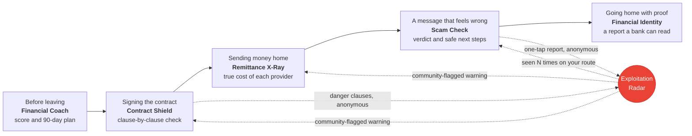

<div align="center">

# NomadFinance

**Your pay. Your contract. Your money home. Protected.**

An AI-powered financial safety net for the world's 280 million migrant workers,
built to work in their own language on the phone already in their pocket.

[**Open the live app**](https://nomadfinance-prod.web.app) ·
[Architecture](./docs/mermaid/system-architecture.mmd) ·
[Changelog](./CHANGELOG.md)

[](https://github.com/google-ai-builder-cup/NomadFinance/actions/workflows/backend-ci.yml)
[](https://github.com/google-ai-builder-cup/NomadFinance/actions/workflows/frontend-ci.yml)
[](https://github.com/google-ai-builder-cup/NomadFinance/actions/workflows/data-ci.yml)


Built for the **Google Cloud AI Builder Cup 2026, BFSI track (JAPAC)**

</div>

---

## Contents

1. [Why NomadFinance exists](#why-nomadfinance-exists)
2. [Meet Priya: one worker, six moments](#meet-priya-one-worker-six-moments)
3. [The six pillars](#the-six-pillars)
4. [Built to be trusted](#built-to-be-trusted)
5. [By the numbers](#by-the-numbers)
6. [How it works](#how-it-works)
7. [Where it works](#where-it-works)
8. [Google Cloud services](#google-cloud-services)
9. [Run it on your machine](#run-it-on-your-machine)
10. [Configuration reference](#configuration-reference)
11. [Tests and checks](#tests-and-checks)
12. [Deploy, CI/CD and operations](#deploy-cicd-and-operations)
13. [Repository map](#repository-map)
14. [Documentation map](#documentation-map)
15. [Contributing](#contributing) · [Team](#team) · [License](#license)

---

## Why NomadFinance exists

About **280 million people** live and work outside the country they were born in. Together they send roughly **$650 billion** home every year, and about **$41 billion** of that disappears into fees. Fees are only the visible loss. A worker who has just arrived somewhere new usually meets every one of these problems alone:

| What goes wrong | What NomadFinance does about it |
|---|---|
| The contract is in a language they cannot read, so they sign things that are illegal where they work | **Contract Shield** reads it, checks every clause against local labor law and explains it in their language |
| Money transfers hide their real cost in exchange-rate markups and layered fees | **Remittance X-Ray** shows what each provider really charges and what the family actually receives |
| Bad agencies, wage theft and illegal deductions, with nobody to warn the next worker | **Exploitation Radar** lets workers report anonymously and warns everyone on the same route |
| Years of honest work leave no financial record anywhere | **Financial Identity** builds a portable report a bank at home can read |
| Scam messages that look like a job, a prize, a loan or the worker's own bank | **Scam Check** explains the trick and what to do next |
| Leaving with no plan, no savings target and no idea what is fair | **Financial Coach** scores their preparedness and writes a 90-day plan |

The project lines up with UN Sustainable Development Goals **8** (decent work), **10** (reduced inequalities, especially target 10.c on remittance costs) and **16** (justice and strong institutions).

---

## Meet Priya: one worker, six moments

Priya is a made-up worker, and the demo data in this repository is built around her. She leaves India to work as a domestic worker in Singapore. NomadFinance is there at every step:



1. **Before she leaves,** the Coach asks her a few simple questions in Hindi and tells her how prepared she is, then gives her a 13-week plan.
2. **When the agency hands her a contract,** she photographs it. Contract Shield reads it, finds the clause that lets the employer keep her passport, and writes a complaint letter she can send to the right authority.
3. **On payday,** Remittance X-Ray shows that the service her agency picked costs her more than other options. The one that leaves her family the most is a tap away.
4. **A text arrives** saying her "bank" needs her one-time code. Scam Check calls it out, shows the pressure trick it uses and reads the next steps aloud. She taps once to warn other workers, with no name attached.
5. **Every report she and others make** feeds Exploitation Radar. The next worker who looks at that agency sees a red "Community flagged" badge before paying or signing.
6. **When she goes home,** her income, bills and savings have been quietly adding up. Financial Identity turns them into a PDF a bank or micro-lender can trust.

---

## The six pillars

Four pillars were in v1.0. **Scam Check** and **Financial Coach** joined in v2.0.0 behind feature flags (see [Built to be trusted](#built-to-be-trusted)).

### 1. Remittance X-Ray: *what does sending money home really cost?*

Pick a route and an amount. NomadFinance ranks every provider by the one number that matters, **how much your family receives**, using real World Bank price data and live exchange rates.

- True total cost per provider: fee plus the hidden exchange-rate markup.
- Rate trends and the best day to send, and what a worker would have saved against the provider they used.
- A short recommendation in the worker's language. A provider that Exploitation Radar has flagged is marked in the table and passed over in the recommendation.
- A transfer log that feeds Financial Identity.

*App:* `/remittance` · *API:* `/api/v1/remittance/*` · *Data:* World Bank *Remittance Prices Worldwide* (221 provider price records, 6 routes) and a four-provider live-rate chain (Frankfurter, then ExchangeRate-API, CurrencyFreaks, Wise) that fails over by itself ([ADR-006](./docs/decisions/ADR-006-fx-provider-failover-chain.md)).

### 2. Contract Shield: *is this contract fair where I work?*

Upload a photo or PDF in any language. A step-by-step Gemini pipeline reads the text, spots the language, country and type of job, and compares each clause with the host country's labor law.

- A **Safe / Caution / Danger** rating, with the risky clauses shown side by side with a plain-language translation (six languages).
- A ready-to-send **complaint letter** addressed to the right authority for that country.
- Clauses that are clearly illegal are reported to Radar automatically and anonymously. The salary the contract states becomes a verified income entry in Financial Identity.

*App:* `/contract` · *API:* `/api/v1/contracts/*` · *Data:* 15 hand-curated labor-law rules for each of the 6 host countries, drawn from ILO NATLEX. They are a careful draft for orientation, **not legal advice**.

### 3. Exploitation Radar: *who else has been hurt by this agency?*

A shared, anonymous memory for workers. Anyone can report an agency, employer or money-transfer operator.

- Gemini checks each report for spam and duplicates and sorts it into a type of abuse.
- Reports about the same business are matched by *meaning* (vector search), so the same complaint written in different words can still be grouped.
- Each business gets a risk profile and community rating, shown on a **heat map** and in per-business pages. A scheduled job spots sudden surges every six hours and sends alerts to workers following that route.
- Reporters are stored only as a keyed hash, never as an account id.

*App:* `/radar` · *API:* `/api/v1/radar/*`

### 4. Financial Identity Builder: *proof of a working life*

Workers log income, bills (snap a photo and Gemini reads it), savings and transfers. Every week NomadFinance turns the history into a score and a plain-language story.

- A score meter and a timeline of progress.
- A **PDF report for banks and lenders** at home. The download link works for 24 hours.
- One activity feed for everything the worker has done in the app.
- *Opt-in only:* Coach plan check-ins and scam-check activity can appear in the report as numbers and dates (never message text). Turning it off removes them from the next report straight away.

*App:* `/identity` · *API:* `/api/v1/fib/*`

### 5. Scam Check: *is this message a trick?* (v2.0, flag `scam`)

Paste a message, upload a screenshot or share one in from another app. The worker sees:

- A verdict and a risk meter, with the words that gave it away highlighted.
- Which of **8 scam types** and **6 pressure tactics** it uses (fake job, illegal recruitment fee, loan trap, remittance OTP phishing, and more), and how many similar scams are already known, including reports from workers on the same route.
- Links, phone numbers, e-mail addresses and chat handles found in the message, with warnings such as "link shortener" or "looks like a bank's address". They are listed but **never opened or contacted**.
- Three plain next steps, which the phone can read aloud.
- A one-tap, anonymous warning to other workers, with a confirmation sheet showing exactly what would be shared.

The same message checked twice is answered instantly from the saved check with no AI call. Each worker gets 20 new checks an hour, and the last 90 days of checks are kept.

*App:* `/scam-check` · *API:* `/api/v2/scam/*` · [API contract](./docs/api/v2-scam.md)

### 6. Financial Coach: *am I ready to leave?* (v2.0, flag `coach`)

A friendly interview, one question at a time, in short plain sentences. The worker taps, fills an amount, types or speaks.

- **Remembers what the app already knows** (country, job, pay from a contract, savings) and asks the worker to confirm instead of repeating questions.
- A **preparedness score from 0 to 100** over five factors, with "what this means" and "how to improve" on each.
- A **13-week plan** with a monthly budget, the cheapest way to send money home, a debt and emergency-fund plan, and a PDF in six languages to download or share.
- Check-ins at **day 30, 60 and 90** after the worker leaves, by push notification.
- Works with a weak signal: answers typed offline wait on the phone and are sent once when the signal returns.
- Stays in its lane: it will not recommend a loan, an investment or an app, and it responds with care to a worker in distress.

*App:* `/coach` · *API:* `/api/v2/coach/*` · [API contract](./docs/api/v2-coach.md)

---

## Built to be trusted

People act on what this app tells them, so the design leans hard on safety. Each principle below can be checked in the repository.

| Principle | How it is done |
|---|---|
| **The AI never invents a number** | The Coach score is plain Python with no model in it. Every figure in a plan is derived from the worker's answers or stored data and checked by code, and a plan that fails the check is refused, never shown. Translated plans and the activity paragraph of the Financial Identity report get the same number check. |
| **Facts come from curated data, not from memory** | Labor-law rules, scam types and tactics, 480 scam templates and cost-of-living baselines are loaded from reviewed files. Each baseline figure carries its source link and the date it was read. |
| **Messages are data, never instructions** | Anything a worker pastes or uploads is passed to Gemini as delimited data. A red-team run of 15 prompt-injection attacks (in all six languages) was judged on content every time, and no system prompt leaked. Links in scam messages are never fetched. |
| **Private by design** | In Scam Check and the Coach, phone numbers, e-mails, IDs, account numbers and links are masked *before* anything is saved or logged. A contract file or scam screenshot is read once and thrown away: only the text is kept. Reports to Radar carry no account id and no raw message. Sharing Coach and scam activity with Financial Identity is opt-in and reversible. A worker can delete their account and everything under it. |
| **New features ship dark** | The two v2.0 modules sit behind flags in Firestore (`config/feature_flags`). With a flag off, their routes answer a plain `404`, their code is never downloaded, and the app behaves exactly as v1.0 did. Rollback is "flag off", with no deploy. |
| **Cost and quota safe** | A per-feature daily Gemini budget degrades to a calm "try again later" instead of failing, repeat questions come from a cache, and every endpoint has a rate limit. Alerts fire before the free-tier quota runs out. |
| **Built for real phones** | An installable PWA, tested at 360 px wide, in light and dark mode and on a slow network, with voice input, read-aloud and an offline answer queue. The interface is in six languages, and the screens were run through the axe accessibility checker and walked with a keyboard. |
| **Honest about limits** | Plans carry a "not professional financial advice" note, and the labor-law data says it is a curated draft. Known limits are stated in this README and in the task runbooks, not hidden. |

---

## By the numbers

| | |
|---|---|
| **6** host countries · **6** money routes · **6** languages | Singapore, South Korea, Malaysia, Japan, Hong Kong, Australia |
| **90** hand-curated labor-law rules | 15 for each host country |
| **221** provider price records | World Bank data across the 6 routes |
| **8** scam types · **6** tactics · **480** reference scam templates | The grounding for Scam Check, 10 templates per language per type |
| **1.000** F1 on the scam golden set | 120 labelled messages (84 scams, 36 genuine) in all six languages, bar was 0.85 overall and 0.75 per language ([report](./docs/evals/scam-eval-2026-10-07.md)) |
| **15 of 15** prompt-injection attacks resisted | [Report](./docs/evals/scam-injection-2026-10-07.md) |
| **12** Coach test personas | A multi-turn regression runner plays them through the real routes |
| **0** serious or critical accessibility issues | axe, every signed-in screen, phone and desktop, light and dark ([details](./docs/runbooks/NF-HR-009-ux-a11y-polish-v2.md)) |
| **0** open High or Critical security findings | OWASP API Top 10 review of the v2 routes ([review](./docs/security-review-v2.md)) |
| **4,000+** backend tests · **1,600+** frontend tests · **14** browser test files | Browser tests run on a phone and a desktop profile |
| **5** scheduled jobs · **11** GitHub Actions workflows | Jobs: exchange rates, radar alerts, Identity recompute, scam statistics, Coach check-ins |

---

## How it works

In plain words: a **React app** on Firebase Hosting talks to a **Python API** on Cloud Run. The API keeps its data in **Firestore**, asks **Gemini** to read, sort, translate and explain, and lets **Cloud Scheduler** run the background jobs. Every route checks the caller's Firebase sign-in first.

The diagrams below show the detail (GitHub draws them; open one and use its zoom):

- [**System architecture**](./docs/mermaid/system-architecture.mmd): every service, store, job and external source.
- [**Cross-pillar data flow**](./docs/mermaid/cross-pillar-data-flow.mmd): which pillar feeds which, and what needs the worker's consent.
- One pipeline per pillar: [Remittance](./docs/mermaid/remittance-xray-pipeline.mmd) · [Contract Shield](./docs/mermaid/contract-shield-pipeline.mmd) · [Radar](./docs/mermaid/exploitation-radar-pipeline.mmd) · [Financial Identity](./docs/mermaid/financial-identity-pipeline.mmd) · [Scam Check](./docs/mermaid/scam-analyzer-pipeline.mmd) · [Coach](./docs/mermaid/financial-coach-pipeline.mmd)

### One model per job

The code never hard-codes a Gemini model. It asks for a *tier*, and the model behind each tier is an environment variable, so a retired model is a one-line change ([ADR-002](./docs/decisions/ADR-002-multi-model-gemini-strategy.md)). Separate models also mean separate free-tier quotas.

| Tier | Used for | Default model | Override |
|---|---|---|---|
| **Reasoning** | Contract clause comparison, complaint letters, the Financial Identity story, the Coach's 90-day plan, scam explanations | `gemini-3.5-flash` | `GEMINI_MODEL_REASONING` |
| **Extraction** | Reading photos and PDFs: contracts, bills, screenshots, radar reports | `gemini-3.5-flash-lite` | `GEMINI_MODEL_EXTRACTION` |
| **Classification** | Fast sorting and translating: scam verdicts, radar checks, categories, recommendations, Coach replies | `gemini-3.1-flash-lite` | `GEMINI_MODEL_CLASSIFICATION` |
| **Embedding** | Turning text into 768 numbers so similar reports and scams can be found | `gemini-embedding-001` | `GEMINI_MODEL_EMBEDDING` |

Everything goes through the `google-genai` SDK with structured output (every answer must fit a Pydantic model), automatic retries, a 30-second default timeout, and token usage logged per feature. Prompts live in [`backend/app/prompts/`](./backend/app/prompts) as versioned YAML files.

### Where the data lives

| Store | Holds |
|---|---|
| **Firestore** (`asia-south1`) | Worker data under `users/{uid}/...` (contracts, transfers, income, bills, savings, Coach sessions and plans, scam checks, profile). Shared reference data (corridors, exchange rates, labor laws, complaint templates, cost baselines, scam taxonomy and templates). Radar reports, entities and alerts. Feature flags and the Gemini usage counter. Schema: [`docs/data-model/`](./docs/data-model/firestore-schema.md). |
| **Cloud Storage** | Bill photos, optional Radar evidence photos, and the PDFs the app creates (Financial Identity report, Coach plan). Contract files and scam screenshots are read once and **not kept**: only their text is. Browsers can read only their own folder. |
| **Secret Manager** | `gemini-api-key`, `radar-reporter-hash-secret`, `currencyfreaks-api-key` (and `wise-api-token` when you add it). No secret is in the repository. |

Access rules (`frontend/firestore.rules`, `frontend/storage.rules`) deny everything the browser does not strictly need, and the API, which uses the Admin SDK, does the rest. Old Coach sessions, scam checks and indicators are deleted automatically by Firestore TTL policies.

### Background jobs

Cloud Scheduler calls protected `/api/v1/internal/*` routes. The API accepts only a Google-signed token from the scheduler's own service account.

| Job | When (UTC) | Does |
|---|---|---|
| `refresh-rates` | every 2 hours | Fetches the six exchange rates into `rates_cache` and `rates_history` |
| `radar-aggregation` | every 6 hours | Spots report surges, writes alerts, notifies subscribed workers |
| `scam-stats` | daily 01:30 | Counts scam checks per route, week and kind (counts only, no text) |
| `coach-checkins` | daily 02:00 | Sends day 30, 60 and 90 reminders, once per milestone |
| `fib-recompute` | Sundays 02:00 | Rebuilds every worker's Financial Identity profile and story |

Logs become metrics, there is a dashboard, and alerts warn when a Gemini model nears its daily limit ([`infra/monitoring/`](./infra/monitoring)).

---

## Where it works

| | |
|---|---|
| **Host countries (6)** | Singapore (SG), South Korea (KR), Malaysia (MY), Japan (JP), Hong Kong (HK), Australia (AU) |
| **Money routes (6)** | SG→PH, SG→IN, AU→IN, MY→ID, JP→PH, AU→PH |
| **Languages (6)** | English (`en`), Hindi (`hi`), Tagalog (`tl`), Bahasa Indonesia (`id`), Nepali (`ne`), Bengali (`bn`) |

All 1,331 interface strings exist in all six languages, and `node scripts/check-i18n.mjs` (run from `frontend/`) lists any that go missing. Home countries covered at sign-up: the Philippines, India, Indonesia, Nepal and Bangladesh.

---

## Google Cloud services

| Service | Role |
|---|---|
| **Gemini** (`google-genai`) | Reading, sorting, translating, explaining, embedding. The intelligence layer. |
| **Firebase Authentication** | Sign in with Google or with a phone number and a code |
| **Cloud Firestore** | Primary database, plus vector search over report and scam embeddings |
| **Cloud Storage** | Bill photos, Radar evidence photos and the PDFs the app creates |
| **Cloud Run** | The FastAPI backend (`nomadfinance-api`, 1 vCPU, 512 MiB, up to 2 instances) |
| **Firebase Hosting** | The React PWA, served from a CDN |
| **Cloud Scheduler** | The five background jobs |
| **Firebase Cloud Messaging** | Radar alerts and Coach check-in reminders |
| **Firebase Analytics** | Anonymous usage counts |
| **Secret Manager** | API keys and the report-hashing secret |
| **Artifact Registry** | The backend container images |
| **Cloud Logging and Monitoring** | Log-based metrics, dashboard and quota alerts |
| **Workload Identity Federation** | GitHub Actions deploys with no stored keys |

---

## Run it on your machine

Everything below runs against **local emulators**: a pretend copy of Firebase on your laptop. You need no Google account and no cloud project, and as long as you set the emulator variables in step 3, nothing can reach production. The only thing that needs a key is Gemini, and without it you can still run the app and the tests.

### 1. Install the tools

| Tool | Version | Check with |
|---|---|---|
| Git | any recent | `git --version` |
| Python | **3.11** (the project is pinned to it; other versions are not supported) | `python --version` |
| Node.js | 20 or newer (22.12+ if you use the commit hooks) | `node --version` |
| pnpm | 10 | `pnpm --version` (install: `npm install -g pnpm@10`) |
| Java | **21 or newer** (the Firebase emulators will not start on older versions) | `java -version` |
| Firebase CLI | 15.31.0 | `firebase --version` (install: `npm install -g firebase-tools@15.31.0`) |
| A Gemini API key | free, from [Google AI Studio](https://aistudio.google.com/apikey) | needed only for the AI features |
| Docker *(optional)* | any recent | builds the production image; the only way to make PDFs on Windows |

```bash
git clone https://github.com/google-ai-builder-cup/NomadFinance.git
cd NomadFinance
```

> [!TIP]
> **On Windows,** clone with `git clone -c core.autocrlf=false https://github.com/google-ai-builder-cup/NomadFinance.git`. Git's Windows default turns every file into CRLF, and then `pnpm format:check` reports hundreds of files that nobody changed. The repository stores LF.

You will use **four terminals**: emulators, data loading, the API, and the web app.

> [!WARNING]
> The data loaders and the API point at the real `nomadfinance-prod` project unless told otherwise. Set the emulator variables in step 3 in **every terminal that runs Python**, before you run a loader. Without them, a loader would use your own Google login and write to production.

### 2. Terminal A: start the emulators

```bash
cd frontend
firebase emulators:start --only auth,firestore,storage --project demo-nomadfinance
```

Leave it running. It serves Auth on `9099`, Firestore on `8085`, Storage on `9199` and a web console at <http://127.0.0.1:4000>. The `demo-` prefix is what keeps it away from real Google services.

### 3. Terminal B: set up the backend

From the repository root:

**Windows PowerShell**

```powershell
cd backend
py -3.11 -m venv .venv
.\.venv\Scripts\Activate.ps1
pip install -r requirements-dev.txt
Copy-Item .env.example .env.local
```

**macOS / Linux / Git Bash**

```bash
cd backend
python3.11 -m venv .venv
source .venv/bin/activate
pip install -r requirements-dev.txt
cp .env.example .env.local
```

Open `backend/.env.local` and set these three values. The API refuses to start without them.

```ini
APP_ENV=local
GEMINI_API_KEY=your-key-from-ai-studio
RADAR_REPORTER_HASH_SECRET=any-long-random-text
```

Also change `FIREBASE_PROJECT_ID=nomadfinance-prod` to `FIREBASE_PROJECT_ID=demo-nomadfinance`. No key yet? Put any text in `GEMINI_API_KEY`: everything except the live AI calls still works. (Shell variables with the same names beat the file, so you can set these three in the terminal instead of editing it.)

Now point this terminal at the emulators. These are real shell variables, not lines for `.env.local`: the Google libraries read them from the shell.

**Windows PowerShell**

```powershell
$env:FIRESTORE_EMULATOR_HOST = "127.0.0.1:8085"
$env:FIREBASE_AUTH_EMULATOR_HOST = "127.0.0.1:9099"
$env:FIREBASE_STORAGE_EMULATOR_HOST = "127.0.0.1:9199"
$env:STORAGE_EMULATOR_HOST = "http://127.0.0.1:9199"
$env:FIREBASE_PROJECT_ID = "demo-nomadfinance"
$env:GOOGLE_CLOUD_PROJECT = "demo-nomadfinance"
```

**macOS / Linux / Git Bash**

```bash
export FIRESTORE_EMULATOR_HOST=127.0.0.1:8085
export FIREBASE_AUTH_EMULATOR_HOST=127.0.0.1:9099
export FIREBASE_STORAGE_EMULATOR_HOST=127.0.0.1:9199
export STORAGE_EMULATOR_HOST=http://127.0.0.1:9199
export FIREBASE_PROJECT_ID=demo-nomadfinance
export GOOGLE_CLOUD_PROJECT=demo-nomadfinance
```

### 4. Terminal C: load the data

A fresh emulator is empty. The loaders are safe to run again. Use a second terminal with the same emulator variables from step 3:

**Windows PowerShell**

```powershell
cd data-scripts
py -3.11 -m venv .venv
.\.venv\Scripts\Activate.ps1
pip install -r requirements-dev.txt
```

**macOS / Linux / Git Bash**

```bash
cd data-scripts
python3.11 -m venv .venv
source .venv/bin/activate
pip install -r requirements-dev.txt
```

Then, after setting the emulator variables in this terminal too:

```bash
python -m src.loaders.corridors
python -m src.loaders.ilo_natlex
python -m src.loaders.complaint_templates
python -m src.loaders.cost_baselines
python -m src.loaders.scam_taxonomy
python -m src.loaders.radar_seed
```

That loads the six money routes with their provider prices, the labor-law rules, complaint-letter templates, cost-of-living baselines, the scam taxonomy and a set of fictional Radar reports for the map.

*Optional:* `python -m src.loaders.frankfurter_backfill` adds a year of exchange-rate history for the trend chart and the savings insight (needs internet, no key). `python -m src.loaders.scam_patterns` embeds the 480 scam templates (needs `GEMINI_API_KEY` in this shell; without it Scam Check works but shows no "similar known scams"). To get the three fictional demo workers, run `python -m src.loaders.demo_accounts`, then `seed`, `demo_coach` and `demo_scam` the same way (`bash scripts/seed_demo.sh` runs everything, then reports what a cold account is still missing). Details: [`data-scripts/README.md`](./data-scripts/README.md).

### 5. Switch on the two new modules, and fetch exchange rates

Two things live outside the loaders. Run `python` in the **backend** terminal (step 3, environment active) and paste this to turn Scam Check and Financial Coach on for everyone:

```python
from google.cloud import firestore
db = firestore.Client(project="demo-nomadfinance")
db.document("config/feature_flags").set({"flags": {"coach": {"enabled": True, "allow_uids": []}, "scam": {"enabled": True, "allow_uids": []}}, "updated_at": firestore.SERVER_TIMESTAMP, "updated_by": "dev", "schema_version": 1})
exit()
```

The API reads the flags at most once a minute, so a change shows up within 60 seconds. For the live exchange rates (production gets them from Cloud Scheduler), save the following as `refresh_rates_local.py` inside `backend/` (do not commit it) and run `python refresh_rates_local.py`. It needs internet access and no keys:

```python
import asyncio
from datetime import UTC, datetime

import httpx

from app.config import get_settings
from app.integrations.fx.router import build_fx_router
from app.repositories.rate_repo import get_rate_repository
from app.services.remittance.rates import refresh_rates


async def main() -> None:
    async with httpx.AsyncClient(timeout=10) as http:
        fx = build_fx_router(get_settings(), http)
        print(await refresh_rates(fx=fx, repo=get_rate_repository(), now=datetime.now(UTC)))


asyncio.run(main())
```

### 6. Terminal B: start the API

```bash
uvicorn app.main:app --reload --port 8080
```

Check <http://127.0.0.1:8080/health> (it answers `"status":"ok"`), and open <http://127.0.0.1:8080/docs> for the interactive API pages. These docs are served only when `APP_ENV=local`.

### 7. Terminal D: start the web app

```bash
cd frontend
pnpm install
pnpm dev --mode emulator --host 127.0.0.1
```

Open **<http://127.0.0.1:5173>**. Use `127.0.0.1`, not `localhost`, so Google sign-in works (`--host` makes the dev server listen on that address). `--mode emulator` loads `frontend/.env.emulator` (demo values, nothing secret) and sends `/api` calls to your API on port 8080.

**Signing in:** choose *Phone*, type any number, then read the six-digit code the emulator made for it:

**Windows PowerShell**

```powershell
Invoke-RestMethod http://127.0.0.1:9099/emulator/v1/projects/demo-nomadfinance/verificationCodes | Select-Object -ExpandProperty verificationCodes
```

**macOS / Linux / Git Bash**

```bash
curl -s http://127.0.0.1:9099/emulator/v1/projects/demo-nomadfinance/verificationCodes
```

*Continue with Google* also works: pick *Add new account*, then *Auto-generate user information*.

### 8. What to try

- Finish the four sign-up questions, then explore the dashboard (a short first-run tour can be skipped). With Scam Check and Coach switched on you see all six pillars.
- **Remittance X-Ray:** pick SG→PH and SGD 260. Provider prices come from step 4 and live rates from step 5, and the services are ranked by what your family receives. The savings insight appears after the optional rate-history backfill.
- **Exploitation Radar:** open the heat map. It shows the fictional reports from step 4, by route.
- **Financial Coach:** it opens with "What we already know", pre-filled from the profile you just created.
- **Contract Shield, scam verdicts, Coach replies and plans, bill scanning, "Get advice":** these call Gemini, so they need a real `GEMINI_API_KEY` in step 3.

### Known limits of a local run

- **PDF files** (the Financial Identity report, the Coach plan) need Pango and related libraries that Windows does not have. Build the production image instead: `docker build -t nomadfinance-backend:local backend`. Also, the Storage emulator cannot sign download links, so a PDF link needs a real project.
- **Google sign-in with real accounts, phone SMS and push notifications** need a real Firebase project. [`frontend/README.md`](./frontend/README.md) explains how to wire one up.
- Gunicorn does not run on Windows. `uvicorn` is the local server, and Docker runs the production setup.

### Stuck?

| Symptom | Fix |
|---|---|
| `app_env Field required` or another "Field required" error at API start | `backend/.env.local` is missing or lacks `APP_ENV`, `GEMINI_API_KEY` or `RADAR_REPORTER_HASH_SECRET` |
| The emulators refuse to start, mentioning Java | Install Java 21 or newer and open a new terminal |
| `ModuleNotFoundError: No module named 'app'` | Run backend commands from the `backend/` folder |
| A loader says it cannot find credentials, or you suspect it targets production | Stop. Set the emulator variables from step 3 in that terminal and run it again |
| `Activate.ps1 cannot be loaded because running scripts is disabled` | Run `.\.venv\Scripts\python -m ...` instead of activating, or relax the PowerShell execution policy for your user |
| Remittance says no prices or rates for a route | Run the loaders (step 4) and the rates script (step 5) |
| Coach or Scam Check is missing from the dashboard | Run the flags snippet (step 5) and wait a minute |
| `pnpm install` ends with a notice about "ignored build scripts" | Harmless. Nothing needs approving |
| An emulator port (8085 or 9150) is "already in use" after a test run on Windows | A leftover Firestore emulator process. Find it with `netstat -ano \| findstr :8085` and end it with `taskkill /PID <number> /F` |

---

## Configuration reference

Nothing secret is stored in the repository. Locally, values come from `backend/.env.local`, `frontend/.env.local` and your shell. In production they come from Cloud Run environment variables and Secret Manager. The backend reads all of its settings in one place, [`backend/app/config.py`](./backend/app/config.py), and **fails at start-up** if a required one is missing.

<details>
<summary><b>Backend</b> (<code>backend/.env.local</code>, template in <code>backend/.env.example</code>)</summary>

| Variable | Required | Default | What it does |
|---|---|---|---|
| `APP_ENV` | **yes** | none | `local`, `staging` or `prod` |
| `GEMINI_API_KEY` | **yes** | none | Gemini key. Prod: Secret Manager `gemini-api-key` |
| `RADAR_REPORTER_HASH_SECRET` | **yes** | none | Secret for hashing report authors. Local: any random text. Prod: `radar-reporter-hash-secret` |
| `CRON_SERVICE_ACCOUNT`, `CRON_AUDIENCE` | when `APP_ENV` is not `local` | none | Who may call the scheduled-job routes, and the service URL their token is for |
| `FIREBASE_PROJECT_ID` | no | `nomadfinance-prod` | Firebase project. Use `demo-nomadfinance` with the emulators |
| `FIREBASE_STORAGE_BUCKET` | no | `nomadfinance-prod.firebasestorage.app` | Bucket for uploads and PDFs |
| `LOG_LEVEL` | no | `INFO` | `DEBUG`, `INFO`, `WARNING` or `ERROR` |
| `GEMINI_MODEL_REASONING`, `_EXTRACTION`, `_CLASSIFICATION`, `_EMBEDDING` | no | see [the model table](#one-model-per-job) | Swap the model behind a tier |
| `GEMINI_TIMEOUT_SECONDS`, `GEMINI_MAX_ATTEMPTS` | no | `30`, `3` | Per-call timeout and retries |
| `GEMINI_EXTRACTION_TIMEOUT_SECONDS`, `GEMINI_COMPARE_TIMEOUT_SECONDS`, `GEMINI_NARRATIVE_TIMEOUT_SECONDS` | no | `90` each | Longer timeouts for the slow steps |
| `GEMINI_RPD_REASONING`, `_EXTRACTION`, `_CLASSIFICATION`, `_EMBEDDING` | no | unset (guard off) | Requests per day each model allows; turns on the per-feature daily budget. Production reads them from `infra/monitoring/quota-limits.json` |
| `GEMINI_COACH_{REPLY,EXTRACT,GUARD,PLAN,TRANSLATE}_TIER` and `_THINKING_BUDGET` | no | see `.env.example` | Which tier each Coach step uses |
| `GEMINI_CHAT_HISTORY_TURNS`, `GEMINI_CHAT_HISTORY_TOKENS` | no | `24`, `6000` | How much of a conversation each reply sees |
| `CURRENCYFREAKS_API_KEY`, `WISE_API_TOKEN` | no | unset | Optional extra exchange-rate providers; a provider with no key is skipped |
| `FX_TIMEOUT_SECONDS` | no | `10` | Per-provider rate fetch timeout |
| `CORS_ALLOWED_ORIGINS` | no | local dev and prod sites | JSON list of allowed browser origins |
| `RATE_LIMIT_ENABLED`, `RATE_LIMIT_DEFAULT`, `RATE_LIMIT_AI`, `RATE_LIMIT_SCAM_ANALYZE` | no | `true`, `60/minute`, `10/minute`, `20/hour` | Request limits per worker |
| `UPLOAD_MAX_BYTES` | no | `10485760` | Largest upload (10 MB) |
| `EXPORT_URL_EXPIRY_MINUTES` | no | `1440` | How long a Financial Identity PDF link works |
| `ACCOUNT_DELETION_MAX_LOGIN_AGE_SECONDS` | no | `300` | How recent a sign-in must be to delete an account |
| `APP_CHECK_ENABLED` | no | `false` | Bot protection on report submission; turn on only with a real reCAPTCHA key wired through |
| `FIRESTORE_EMULATOR_HOST`, `FIREBASE_AUTH_EMULATOR_HOST`, `FIREBASE_STORAGE_EMULATOR_HOST` | local only | unset | Shell variables that point at the emulators. The API **refuses to start** with any of them set when `APP_ENV` is not `local` |

</details>

<details>
<summary><b>Frontend</b> (<code>frontend/.env.local</code>, template in <code>frontend/.env.example</code>)</summary>

Not needed in emulator mode (`pnpm dev --mode emulator` uses `frontend/.env.emulator`). For a real Firebase project, get the values with `firebase apps:sdkconfig WEB --project <your-project>`. These are public identifiers that ship in the browser bundle, not secrets.

| Variable | Required | What it does |
|---|---|---|
| `VITE_FIREBASE_API_KEY`, `VITE_FIREBASE_PROJECT_ID`, `VITE_FIREBASE_APP_ID` | yes (real project) | Firebase web app configuration |
| `VITE_FIREBASE_AUTH_DOMAIN` | yes | The app's own Hosting domain (`nomadfinance-prod.web.app`), so Google sign-in works |
| `VITE_API_BASE_URL` | for a deployed site | The Cloud Run URL. Leave empty in development: Vite forwards `/api` to `127.0.0.1:8080` |
| `VITE_FIREBASE_MEASUREMENT_ID` | no | Turns on Firebase Analytics. Unset means no analytics |
| `VITE_FIREBASE_MESSAGING_SENDER_ID`, `VITE_FIREBASE_VAPID_KEY` | no, both or neither | Push notifications |
| `VITE_FIREBASE_APPCHECK_SITE_KEY` | no | reCAPTCHA v3 site key for Radar report protection |
| `VITE_USE_FIREBASE_EMULATOR`, `VITE_FIREBASE_AUTH_EMULATOR_URL`, `VITE_FIRESTORE_EMULATOR_PORT` | local only | Use the emulators. Set for you by `--mode emulator` |

</details>

<details>
<summary><b>Data scripts</b> (read from your shell)</summary>

| Variable | What it does |
|---|---|
| `FIRESTORE_EMULATOR_HOST`, `FIREBASE_AUTH_EMULATOR_HOST`, `STORAGE_EMULATOR_HOST` | Send the loaders to the emulators. **Leave them unset and the loaders use your Google login against `nomadfinance-prod`** |
| `FIREBASE_PROJECT_ID` | Target project (default `nomadfinance-prod`; use `demo-nomadfinance` with the emulators) |
| `FIREBASE_STORAGE_BUCKET` | Bucket for the sample contracts |
| `GEMINI_API_KEY` | Only for `scam_patterns` (embeddings) and the scam eval. Never put it in a committed file |

</details>

<details>
<summary><b>CI and deployment</b> (GitHub repository settings and Secret Manager)</summary>

| Where | Name | Used by |
|---|---|---|
| GitHub *variables* | `VITE_FIREBASE_API_KEY`, `VITE_FIREBASE_APP_ID`, `VITE_FIREBASE_MEASUREMENT_ID`, `VITE_API_BASE_URL` | Frontend deploy (the build fails early if the first two are empty) |
| GitHub *secret* | `GEMINI_API_KEY` | The manual Scam eval workflow |
| GitHub *secrets* and a *variable* | `COACH_EVAL_FIREBASE_WEB_API_KEY`, `COACH_EVAL_REFRESH_TOKEN`; variable `COACH_EVAL_BASE_URL` | The manual Coach regression workflow, which signs in as a dedicated test account on which the `coach` flag is on |
| Secret Manager | `gemini-api-key`, `radar-reporter-hash-secret` (required); `currencyfreaks-api-key`, `wise-api-token` (optional); `recaptcha-secret-key` (reserved for App Check) | Mounted onto Cloud Run by `backend/scripts/deploy_manual.sh` |

</details>

---

## Tests and checks

Commands are identical on macOS, Linux and Windows unless a PowerShell variant is shown. **CI runs the same commands on every pull request**, so running them first saves a round trip. Run backend commands from `backend/` with its virtual environment active, and frontend commands from `frontend/`.

| What | Command | Needs |
|---|---|---|
| Backend lint and types | `ruff check .` then `black --check .` then `mypy app` | the backend environment |
| Backend unit and API tests, Gemini replaced by recorded answers | `pytest -q` | the backend environment |
| Backend tests against the Firestore and Auth emulators | `firebase emulators:exec --only firestore,auth --project demo-nomadfinance --config ../frontend/firebase.json "python -m pytest tests/integration -q"` | Java 21, Firebase CLI |
| Frontend lint and formatting | `pnpm lint` then `pnpm format:check` | `pnpm install` |
| Frontend unit and component tests, API mocked from [`docs/mocks/`](./docs/mocks) | `pnpm test` (with coverage floors: `pnpm test:coverage`) | `pnpm install` and the four placeholder variables below |
| Frontend types and production build | `pnpm build` | `pnpm install` |
| Every language has every text | `node scripts/check-i18n.mjs` | Node |
| Firestore and Storage security-rule tests | `pnpm test:rules` | Java 21, Firebase CLI |
| Data-script checks | `ruff check .`, `black --check .`, `mypy src tests`, `pytest -q` from `data-scripts/` | the data-scripts environment |
| Is the curated data still loadable? | `python -m src.validators.labor_law --require-all`, then `python -m src.loaders.ilo_natlex --dry-run` and `python -m src.loaders.corridors --dry-run` | no cloud access |

**The frontend unit tests need four placeholder values** (CI sets the same ones), or about 18 test files fail to load with "Missing VITE_FIREBASE_API_KEY". They are public-style identifiers with no meaning, and nothing is deployed with them. Set them in the terminal you run `pnpm test` in, or put them in `frontend/.env.local`:

**Windows PowerShell**

```powershell
$env:VITE_FIREBASE_API_KEY = "ci-placeholder"
$env:VITE_FIREBASE_AUTH_DOMAIN = "nomadfinance-prod.web.app"
$env:VITE_FIREBASE_PROJECT_ID = "nomadfinance-prod"
$env:VITE_FIREBASE_APP_ID = "ci-placeholder"
```

**macOS / Linux / Git Bash**

```bash
export VITE_FIREBASE_API_KEY=ci-placeholder VITE_FIREBASE_AUTH_DOMAIN=nomadfinance-prod.web.app
export VITE_FIREBASE_PROJECT_ID=nomadfinance-prod VITE_FIREBASE_APP_ID=ci-placeholder
```

> [!NOTE]
> **Known on Windows only:** up to three backend tests can fail on a Windows machine without anything being wrong: two scam-history tests that depend on the clock ticking faster than Windows' does, one test that blocks the network and trips over Windows' event loop, and, now and then under the full emulator run, a Coach "two sessions at once" test that passes when run alone. They are known, and Linux CI is green. One browser accessibility test can also fail once in a full run on a busy machine. Also on Windows, `firebase emulators:exec` can leave the Firestore emulator's Java process running; see "Stuck?" above.

**Browser tests** (Playwright, on a phone and a desktop profile) sign in through the emulators and answer API calls from the saved mocks, so they need no backend and no Gemini key. Build the app in emulator mode first, then run the tests inside the emulators:

**Windows PowerShell**

```powershell
$env:VITE_API_BASE_URL = "http://127.0.0.1:4173"
pnpm exec vite build --mode emulator
pnpm exec playwright install chromium
firebase emulators:exec --only auth,firestore --project demo-nomadfinance "pnpm test:e2e"
```

**macOS / Linux / Git Bash**

```bash
VITE_API_BASE_URL=http://127.0.0.1:4173 pnpm exec vite build --mode emulator
pnpm exec playwright install chromium
firebase emulators:exec --only auth,firestore --project demo-nomadfinance "pnpm test:e2e"
```

By default no test calls the real Gemini API or a real Google project: Gemini is replaced by recorded answers (`backend/tests/fixtures/gemini/`), live-model tests run only with `RUN_LIVE_GEMINI=1`, and the emulator fixtures refuse to run against anything that is not on your own machine. Fixtures, examples and how to write the next test: [`docs/runbooks/NF-F0-014-test-harness.md`](./docs/runbooks/NF-F0-014-test-harness.md).

**Checks that call real Gemini (run by hand, on purpose):**

| Check | Command | Passes when |
|---|---|---|
| Scam golden-set evaluation (120 messages) | from `data-scripts/`: `python -m evals.run_scam_eval` ([steps](./docs/runbooks/NF-SA-014-scam-eval-runner.md)) | F1 ≥ 0.85 overall and ≥ 0.75 in every language |
| Coach multi-turn regression (12 personas) | from `backend/`: `python -m tests.regression.run_coach_regression` ([steps](./docs/runbooks/NF-FC-024-coach-regression.md); needs a running API and a signed-in test account) | every persona passes |
| Load test (Locust against the real API) | [`backend/tests/load/README.md`](./backend/tests/load/README.md) | no failures |

Both evaluations also have manual GitHub workflows (*Scam eval*, *Coach regression* in the Actions tab).

---

## Deploy, CI/CD and operations

Merging to `main` deploys. Nobody holds a cloud key: GitHub Actions signs in to Google with short-lived tokens (Workload Identity Federation).

| Workflow | Starts when | What it does |
|---|---|---|
| **Backend CI**, **Frontend CI**, **Data scripts CI** | every pull request | Lint, types, tests, coverage gates (70% per changed package, 93% overall for the backend), build, emulator and browser tests |
| **Commit policy** | every pull request | Checks every commit message (`<type>(<scope>): <summary>` plus an optional `Refs: NF-XXX-NNN`) |
| **Security scan** | pull requests, `main`, Mondays | Dependency advisories for Python and JavaScript |
| **Backend deploy** | `backend/**` changes on `main` | Builds the image, pushes it to Artifact Registry, deploys Cloud Run `nomadfinance-api`, then checks `/health` |
| **Frontend deploy** | `frontend/**` changes on `main` | `pnpm build`, deploys Firebase Hosting, then checks the live site |
| **Firestore and Storage rules deploy** | rule file changes on `main` | Runs the rule tests, then deploys the rules |
| **Cloud Scheduler deploy** | `infra/cloud-scheduler/**` changes on `main` | Creates or updates one job per YAML file (an empty file is skipped) |
| **Scam eval**, **Coach regression** | by hand only | The real-Gemini checks above |

> [!NOTE]
> **Firestore indexes are not deployed by any workflow.** They were created by hand, and `frontend/firestore.indexes.json` lists fewer indexes than production has. Do not deploy that file as it is. Cloud Run settings live in `backend/scripts/deploy_manual.sh`, and the YAML files in `infra/cloud-run/` are empty placeholders.

**Feature flags.** `config/feature_flags` in Firestore holds one entry per module (`coach`, `scam`) with `enabled` and an `allow_uids` list for named testers. Edit it in the Firebase console and the API picks it up within a minute. No deploy needed. Format: [`docs/data-model/collections/config.md`](./docs/data-model/collections/config.md).

**Rolling back** is three levers, in this order: switch the flag off, redeploy the previous Cloud Run revision, roll back the Hosting release. Step by step: [`docs/runbooks/NF-HR-011-release-v2.0.md`](./docs/runbooks/NF-HR-011-release-v2.0.md).

**Releases.** [`CHANGELOG.md`](./CHANGELOG.md) is built from the commit history by [`infra/release/generate_changelog.py`](./infra/release/generate_changelog.py). Versions follow [Semantic Versioning](https://semver.org).

---

## Repository map

```text
NomadFinance/
├── backend/                  FastAPI service (Python 3.11), runs on Cloud Run
│   ├── app/api/v1/           Routes of the four original pillars, plus the scheduled-job routes
│   ├── app/api/v2/           Scam Check, Financial Coach and feature-flag routes
│   ├── app/services/         The business logic, one folder per pillar (plus cross_pillar/)
│   ├── app/repositories/     The only code that talks to Firestore
│   ├── app/integrations/     Gemini client, exchange-rate providers, ILO
│   ├── app/prompts/          Versioned Gemini prompts (YAML)
│   ├── app/schemas/          Pydantic models for every request, response and Gemini answer
│   ├── app/core/             Sign-in checks, logging, rate limits, errors, PII masking, streaming
│   └── tests/                unit, integration (emulator), regression, load
├── frontend/                 React 18 + Vite + TypeScript PWA, runs on Firebase Hosting
│   ├── src/                  pages, components, hooks, services, i18n (6 languages), mocks
│   ├── e2e/                  Playwright browser tests
│   └── firebase.json         Hosting and emulator setup, with firestore.rules, storage.rules, indexes
├── data-scripts/             Loaders, validators, seed data and evaluation sets
├── infra/                    Scheduler jobs, monitoring, IAM notes, release tooling
├── docs/                     Design, API contracts, data model, decisions, runbooks, diagrams
└── .github/                  CI/CD workflows, issue and pull request templates
```

Also at the root: `CHANGELOG.md`, `.pre-commit-config.yaml` and `commitlint.config.cjs` (commit checks).

---

## Documentation map

| You want to know | Read |
|---|---|
| How the pipelines work | [`docs/mermaid/`](./docs/mermaid) |
| The API | [v1 endpoints](./docs/api/endpoints.md) · [v2 conventions](./docs/api/v2-conventions.md) · [flags](./docs/api/v2-flags.md) · [OpenAPI export](./docs/api/openapi.json) |
| The database | [`docs/data-model/`](./docs/data-model/firestore-schema.md) |
| Why a choice was made | [`docs/decisions/`](./docs/decisions) (ADRs: Firestore, multi-model Gemini, no mock data, PWA, scope, FX failover) |
| How a task was done and how to repeat it | [`docs/runbooks/`](./docs/runbooks), one page per task id |
| How well the AI parts perform | [`docs/evals/`](./docs/evals) and [Gemini prompt notes](./docs/gemini-prompts.md) |
| Security | [`docs/SECURITY.md`](./docs/SECURITY.md) · [v2 security review](./docs/security-review-v2.md) |
| Per-folder detail | [backend](./backend/README.md) · [frontend](./frontend/README.md) · [data-scripts](./data-scripts/README.md) · [infra](./infra/README.md) |

---

## Contributing

Read [`docs/CONTRIBUTING.md`](./docs/CONTRIBUTING.md) first. The short version:

- Branch from fresh `main` as `feature|fix|chore|docs|test/<scope>-<short-description>`.
- Install the commit hooks once with `pre-commit install`. They run ruff, black, eslint, prettier and a secret scan, and they check the commit message.
- Commit messages look like `feat(coach): add day 30 check-in reminders`, with `Refs: NF-XXX-NNN` as the only extra line.
- Keep a pull request under about 400 changed lines. Put big work behind a feature flag.
- Never commit a secret or real worker data. Test data is invented or fully anonymised.
- Python is formatted with black (line length 100) and checked with ruff and mypy. TypeScript runs in strict mode and every user-facing string goes through i18n keys in all six languages.

To report a security problem, see [`docs/SECURITY.md`](./docs/SECURITY.md).

## Team

Built by **Devam**, **Aditya** and **Pranjal** for the Google Cloud AI Builder Cup 2026, under the [google-ai-builder-cup](https://github.com/google-ai-builder-cup) organisation.

## License

MIT. See [LICENSE](./LICENSE).
