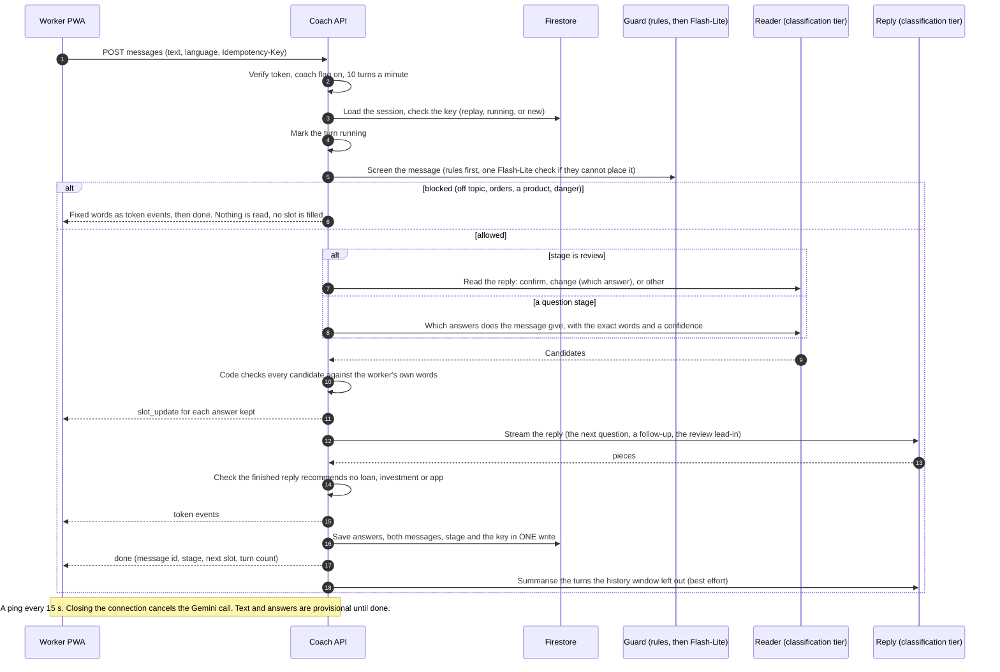
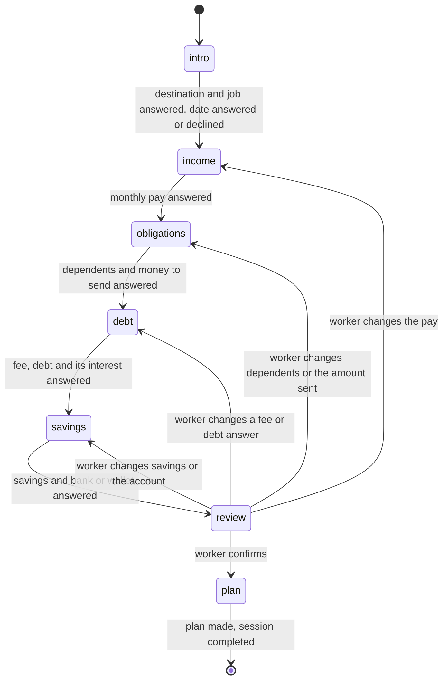
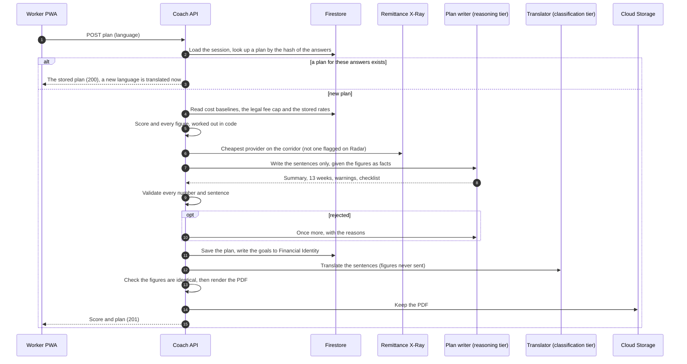

# Financial Coach

A migrant worker who is about to leave answers a short interview in their own language and gets a preparedness score, a 13-week plan with a PDF, and a reminder at day 30, 60 and 90 after they leave. The coach asks one question at a time, in short plain sentences, and the worker answers by tapping, filling an amount or typing.

It is a Future Scope module. It is **off for everyone until the `coach` flag is switched on** (see "Turning it on"), it is additive to the four pillars, and it reads from three of them (Contract Shield, Financial Identity and Remittance X-Ray) and writes goals back to Financial Identity.

| | |
|---|---|
| Screens | `/coach` (the interview, the review, the score), `/coach/plan/:planId` (the plan and its PDF), `/coach/checkin/:planId?m=30` (the day 30, 60 and 90 check-in), and a card on the home screen |
| API | `POST /api/v2/coach/sessions`, `GET /sessions/{id}`, `POST /sessions/{id}/known`, `POST /sessions/{id}/messages` (a stream), `POST /sessions/{id}/plan`, `GET /plans/{id}`, `GET /plans/{id}.pdf`, `GET /overview`, `PUT /plans/{id}/checkins/{milestone}`. The contract is [`docs/api/v2-coach.md`](../api/v2-coach.md) and the mocks are `docs/mocks/coach/` |
| Design | [`docs/future-scope/design.md`](../future-scope/design.md) section 4; pipeline diagram `docs/mermaid/financial-coach-pipeline.mmd` |
| Score and plan | [`coach-scoring.md`](coach-scoring.md) (the rubric) and [`coach-plan.md`](coach-plan.md) (the plan rules). This page summarises both and links to them; the numbers live there |
| Prompts | [`docs/gemini-prompts.md`](../gemini-prompts.md) |
| Built in | NF-FC-001 to NF-FC-025. Each task has a runbook in [`docs/runbooks/`](../runbooks/) named `NF-FC-0nn-*.md` |

## What a worker sees

1. **The card on the home screen** says **Start my interview**, **Continue my interview** (the step, "Step 4 of 6", and when they last answered) or **View my plan** (the score and its band).
2. **What the Coach already knows.** If the worker's profile, their latest analysed contract or their Financial Identity records answer some questions (country, kind of work, pay, money sent home, savings, bank or wallet), a card lists them before the first question, each with where it came from and a date. **Use these answers** keeps the rows not marked Change; **Ask me every question** keeps none. Nothing a worker changes here is written back to the profile or the records.
3. **The interview.** The coach speaks first. Each question comes with the helper that fits it: country, kind of work and bank are chips; pay, money to send home, fee, debt and savings are an amount with a currency (and how often, for pay); dependents is a number; the interest is a rate and a period; the leaving date is a date with **I do not know yet**. **Type my own answer** is always there, and in English, Hindi and Indonesian a microphone fills the box with what was heard (it never sends). The helpers write the answer as a sentence ("4200 AUD per month"), which the server reads exactly like typed words. A row of six steps shows where the worker is. **New interview** is always on that row and asks first.
4. **The coach's language can change at any point.** A selector in the header changes the language of the whole app, and the coach carries on from the same question in the new language with every answer kept.
5. **The review.** The coach says it has all the answers and asks the worker to check a table of them, one row for each question with a **Change** button. **Yes, that is right** confirms them; a change goes back to the question that holds that answer.
6. **The score.** A ring with the total, the band in words, and one card for each of five factors with *what this means* and *how to improve*. **Make my 90-day plan** takes up to a minute and shows progress.
7. **The plan.** The summary, the warnings (most serious first), the monthly budget, the money to send home with a link into Remittance X-Ray (the corridor and amount already filled in), the debt and the emergency fund, the 13 weeks, a checklist the worker can tick (kept on the phone), and the PDF to **download** or **share**. The plan follows the app's language; a language not yet stored is translated on first request.
8. **Day 30, 60 and 90.** A push and a notification carry a link to three questions with fixed answers (money sent home, saving, and whether the employer pays in full and on time). The first answers are kept.
9. **Coming back.** A worker who returns to an interview under way is welcomed back at the same step with what they typed and did not send. An answer sent with no signal waits on the phone as **Waiting for signal** and is delivered once when the connection returns.

## How a turn works (as built)

- **The model proposes, code decides.** The reader finds candidates; `extraction_checks.py` keeps one only if the worker's own words state it. A figure needs a number the worker wrote; a currency must be one the worker **named** (never taken from the country or language); a period must have been said; an interest needs a percent; the quoted words must really be in the message. A reading it cannot confirm is asked about, never kept as confirmed. The model's confidence only decides *how* it is kept: 0.8 or more is confirmed, 0.5 to 0.8 is kept and checked, under 0.5 is not used.
- **A gap is a question, not a guess.** A missing currency ("Which money is that in?"), a missing period, an amount outside the usual range (kept unconfirmed and asked about) or an unsure reading each triggers the question bank's follow-up wording, and nothing wrong is stored.
- **The next question comes from the question bank and the state machine, not from the model.** The reply model only puts it in the worker's language, and it may repeat only figures that are in the stored answers.
- **Facts before words.** A `slot_update` normally comes before the first `token`. A client must not depend on the order, and treats everything as provisional until `done`.
- **Idempotency.** `Idempotency-Key` is required. The same key and body after a finished turn is replayed from storage and runs nothing; a second turn while one is running is `409 turn_in_progress`; a turn running for more than 90 seconds counts as failed. Only the latest turn can be replayed, for 24 hours.

### Steps, prompts and models

| Step | Prompt | Tier and model today | Notes |
|---|---|---|---|
| Screen the message | rules, then `coach/guard.v1` | rules; classification, `gemini-3.1-flash-lite` | The rules decide most turns with no model call |
| Read the answers | `coach/extract.v1` | classification, `gemini-3.1-flash-lite`, thinking off | Temperature 0 |
| Read the reply at the review | `coach/review.v1` | the same tier as the reader | A yes needs confidence 0.85 and the quoted words in the message |
| Write the reply | `coach/reply.v2` | classification, thinking off (`GEMINI_COACH_REPLY_TIER`) | Temperature 0.3, streamed |
| Summarise older turns | `coach/summarise.v1` | classification | After `done`, so it lags one turn (D-212) |
| Score | no model | pure Python | `scoring.py` |
| Write the plan's words | `coach/plan.v1` | reasoning, `gemini-3.5-flash`, thinking budget 1024 | Temperature 0.3, 90 s, 20 to 40 s on a free-tier key |
| Translate the plan | `coach/translate_plan.v1` | classification | Only sentences are sent |

The tier behind each step is a setting (`GEMINI_COACH_*_TIER` in `backend/app/config.py`), and the model behind a tier is another (`GEMINI_MODEL_*`).

## The interview as a state machine

| Stage | Questions |
|---|---|
| `intro` | `destination_country`, `job_type`, `departure_date` (the only optional one) |
| `income` | `monthly_salary` |
| `obligations` | `dependents`, `remittance_target` |
| `debt` | `recruitment_fee_paid`, `debt_outstanding`, `debt_interest` (not asked when the debt is 0) |
| `savings` | `savings`, `bank_or_wallet` |
| `review`, `plan` | none |

- **The stage is where the answers stand, not a counter.** A stage is complete when every question it applies has a **confirmed** answer. A worker who volunteers a later fact keeps it, and the stage is the earliest incomplete one. A move not in the diagram is refused with no write.
- **The leaving date can be declined.** "I do not know yet" is recorded in `declined_slots`, so "not sure" is told apart from "not asked yet" and the stage can move on without it.
- **At the review** the worker confirms (every answer becomes confirmed, stage `plan`) or changes one (the answer is un-confirmed and the interview goes back to the stage that holds it; once re-answered it settles forward to `review` again). "I want to change something" with no answer named makes the coach ask which.
- **Status** is separate from stage. `active` becomes `completed` (a plan was made) or `abandoned` (14 days without a turn, or **New interview**). A finished session never reopens.
- **One active session per worker**, checked and created in one Firestore transaction. A write carries the revision it read, so two tabs cannot overwrite each other.
- **Every state change is saved with the turn**, in one write, so a server restart mid-interview resumes at the same stage.

## What the Coach already knows

Three sources feed the interview, always as an offer the worker confirms. None is used before the worker says yes.

| Source | What it offers | How |
|---|---|---|
| The profile (`users/{uid}`) | Country, kind of work | In the card before the first question |
| Financial Identity | Money sent home (average of the months with a transfer, last 90 days), savings (deposits minus withdrawals, when above zero), bank or wallet, and pay (the newest logged salary taken as one month, only when there is no contract salary) | In the same card, with the date of the newest entry |
| Contract Shield | The pay of the latest analysed contract with a salary | In the same card ("From your contract"). A session that has no card asks it in the chat at the income stage instead: "Your contract with {employer} says the pay is {amount}. Is that right?" A yes confirms it; another figure replaces it; anything else drops the offer. A daily or hourly pay is not offered |

Going the other way, a made plan writes its targets (savings rate, remittance cadence, emergency-fund target) into `users/{uid}/financial_profile/current.goals`, where the Financial Identity weekly recompute keeps them.

## The score

The score is **pure arithmetic**: no model, no randomness, no clock. Version 1 of the rubric, in full in [`coach-scoring.md`](coach-scoring.md).

| Factor | Weight | Measures |
|---|---|---|
| `debt_to_income` | 0.30 | Months of pay still owed, less 10 or 20 points for interest of 24% or 48% a year or more |
| `emergency_buffer` | 0.25 | Months the savings cover the essential costs plus the money sent home |
| `remittance_ratio` | 0.15 | The share of pay sent home; at most 25 points when the worker plans to send more than they can afford |
| `recruitment_fee_vs_cap` | 0.20 | The fee paid against what the host country's law lets an agent charge, in months of pay |
| `banked_status` | 0.10 | `both` 100, `bank_account` 90, `mobile_wallet` 55, `none` 0 |

`total = round half up(sum of weight x points)`. Bands: `needs_work` 0 to 39, `getting_ready` 40 to 69, `well_prepared` 70 to 100. **Floor rule:** any factor under 20 points keeps the band at `getting_ready` or below, even if the total is 70 or more.

Every amount is first converted into the host country's currency with the stored exchange rate of the corridor. If an amount is in a currency with no stored rate (NPR and BDT today, D-170), or the host's cost baseline is missing, the score is `null` and the screen says so with **Try again**; the rubric never guesses a rate. The score is not stored on the session, it is worked out when read (D-208); the plan stores the score it was made with, and that one counts.

The score is a guide, not a credit score, and every screen and PDF carries the "not professional financial advice" note.

## The plan

`POST /sessions/{id}/plan` makes the plan from the confirmed answers; the rules are in [`coach-plan.md`](coach-plan.md).

- **Code writes every figure; Gemini writes sentences.** The budget, the goals, the remittance schedule, the debt payment, the emergency fund and the provider quote are worked out in `plan_figures.py`. The model returns only words, and a validator rejects any number that is not a figure it was given (to the precision written), any "thousand" or "lakh", any link, and any advice to borrow, invest or insure. A second rejection is `502 ai_bad_response` and **nothing is stored**.
- **Idempotent.** The plan id is the first 20 hex characters of the SHA-256 of the answers' values, so asking again for the same answers returns the same plan, and changing a value makes a new one. A second request while the first is running is `409 request_in_progress`.
- **Translation.** The plan is written in English once. Another language is made on first request and kept. Before saving, the translated plan with its sentences taken out must equal the English one, byte for byte, and every number and currency code in every sentence must match.
- **The PDF** is made with weasyprint with Noto fonts (Latin, Devanagari, Bengali), in all six languages, kept at `exports/{uid}/coach-plan-{id}-{language}.pdf` and returned **through the API** with the bearer token, not as a signed link (the bucket has no CORS policy, and a link anyone can open would be a link to a worker's debts).

## Guardrails

Every worker message is screened **before anything reads it**. The common turn, an ordinary answer, passes on rules alone with no extra model call.

| What the worker sends | What happens |
|---|---|
| An answer ("I will earn 2000 SGD a month", "domestic helper", "yes") | Passes on the rules |
| Something off topic | One Flash-Lite check says `off_topic`; the coach answers with a fixed redirect: it can only help plan money before leaving, please answer the last question |
| An order to the coach ("ignore all previous instructions", a fake `SYSTEM:` turn, a closing tag, the same in the six languages, with digits for letters, spaced out or encoded) | Rules, or the check for the encoded one; the same redirect. The order is not repeated or discussed |
| A request to choose a loan, lender, investment, insurance, app, bank or company | Rules; a fixed reply that the coach cannot recommend loans, investments, apps or companies |
| A sign of danger (hurt, threatened, held, passport taken, no food, talk of dying) | Checked **first**. A fixed referral: sorry, talk to someone you trust, contact your embassy or a support group for migrant workers, call the local emergency number if in danger now |
| The worker telling the coach about their own loan or agent ("I owe 3000 SGD") | An answer, never blocked |
| The coach's own reply recommending a product | The stream ends in `error` (`ai_bad_response`), **nothing is saved** |

- **Rules, in order** (`guard_rules.screen`): danger, orders to the coach, a product request, an answer shape, and otherwise `None`, which goes to `coach/guard.v1`. The model's label blocks a turn at confidence 0.7 and a danger label at 0.5; an unsure label lets the turn through.
- **A blocked turn is fixed words, then `done`.** There is no `slot_update`, the stage and next question do not move, and the turn is saved and replayable like any other. The words are the same for everyone in each language (`guard_texts.py`), so a screen cannot tell a blocked turn from any other.
- **The referral names no organisation and gives no phone number**: the repository holds no sourced contact data, and a wrong number in a message to someone in danger is worse than none (D-224). A test holds every language's referral to no digit and no link.
- **Untrusted text is data everywhere.** The worker's message is masked (phone, email, ID, account, URL), put inside delimiters in every prompt (`</worker_message` inside it is rewritten so it cannot close its own section), and never in a `system` instruction. An earlier message that gave orders is replaced in the history both models see.
- **Logging.** One line per turn, never with the text: `coach_guard action=redirect reason=injection_cue source=rule`. The reason codes are listed in [`NF-FC-013`](../runbooks/NF-FC-013-coach-guardrails.md).
- **The note.** Every score and plan, and the PDF, carries "not professional financial advice" in the worker's language as fixed wording, never as a translation.

## Check-ins

A Cloud Scheduler job (`coach-checkins`, daily 02:00 UTC, authenticated with an OIDC token) calls `POST /api/v1/internal/send-coach-checkins`. For each plan whose departure date plus 30, 60 or 90 days is today (or fell in the last 3 days) it writes a `coach_checkin` notification with the link `/coach/checkin/{planId}?m=30` and sends a push, in the worker's language.

- **Once per plan per milestone, however often the job runs.** The notification id is made from the plan and the milestone and `create` fails when it exists; the marker on the plan is written last.
- **Only the newest plan is reminded**, and not for a worker the `coach` flag is off for or who turned reminders off.
- **The answers.** `PUT /plans/{id}/checkins/{milestone}` stores the three fixed choices, open from the milestone's day, and the first answers are kept: a second call changes nothing and returns them.

## What is stored, and what is not

| Where | What | How long |
|---|---|---|
| `users/{uid}/coach_sessions/{id}` | The stage, the answers, the transcript (masked: phone, email, ID, account, URL), the key of the latest turn, the summary | 30 days after the last turn, then deleted by a TTL policy; 14 days without a turn marks it `abandoned` |
| `users/{uid}/coach_plans/{id}` | The score, the plan, the answers it was made from, what the figures were derived from, the check-in answers | Until the account is deleted |
| `coach_plans/{id}/translations/{language}` | The plan's sentences in another language | With the plan |
| Cloud Storage `exports/{uid}/coach-plan-{id}-{language}.pdf` | The PDF | With the other exports; account deletion removes it |
| `users/{uid}/financial_profile/current.goals` | The plan's targets | With the profile |
| On the phone only | Drafts of what was typed, an answer waiting for a connection, the ticks on the checklist | Until sent, restart or sign-out |

**Not stored:** the worker's raw text (only the masked one) and voice recordings (the browser's speech service turns them into text and nothing is kept). The session records which models and prompt versions made its last turn. Gemini token counts are logged per call, keyed by request id and hashed user id, never with the text.

Data model: [`docs/data-model/collections/coach.md`](../data-model/collections/coach.md).

## Errors the screen handles

| Case | What the worker sees |
|---|---|
| The stream drops | The half reply is thrown away; one automatic resend with the same key, then **Try again** |
| No signal | The answer waits on the phone ("Waiting for signal") and goes by itself |
| Gemini busy, slow or down (`503`, `504`) | "The coach is busy. Your answers are safe." with **Try again**; the session is intact |
| `409 turn_in_progress` | "The coach is still working on your last message" |
| The interview ended, is full or is gone | The reason and **Start a new interview** |
| The score cannot be worked out (`null`, `503 score_unavailable`) | "We cannot work out your score right now" with **Try again** |
| The plan failed its checks twice (`502`) | "We cannot make your plan right now" with **Try again**; nothing stored |
| Over 1,000 characters | The box refuses to send; the text is never cut |
| 10 turns in a minute | "You are sending messages very fast" with the wait |

## Evaluation

| Measure | Result | Where |
|---|---|---|
| **Reading the answers**, the 12 personas, real Gemini | **128 of 128 right, none invented**, every expected follow-up asked (2026-10-09, `gemini-3.1-flash-lite`, `coach/extract.v1`) | [`NF-FC-010`](../runbooks/NF-FC-010-coach-slot-extraction.md) |
| **Score** | Matches the hand-worked score of all 12 personas | `test_coach_scoring_personas.py`, [`NF-FC-007`](../runbooks/NF-FC-007-coach-personas.md) |
| **Plan, real Gemini** | 10 of 12 personas accepted live (5 to 15 s each; about a third of first answers were rejected and accepted on the second try). Personas 9 and 12 not run live; not re-run after the last advice-check change (D-220) | [`NF-FC-012`](../runbooks/NF-FC-012-coach-plan-generator.md) |
| **Translation, real Gemini** | Persona 1 into hi, tl, id, ne and bn: all accepted with every figure intact. The other eleven personas not run live | [`NF-FC-014`](../runbooks/NF-FC-014-coach-plan-translation-pdf.md) |
| **Guardrails** | 20 adversarial cases, 16 decided by the rules with no model. The live check (`coach/guard.v1`) has only run against a stand-in (D-227) | [`NF-FC-013`](../runbooks/NF-FC-013-coach-guardrails.md) |
| **Multi-turn regression** | A runner replays the 12 personas through the real endpoints and checks the turn count, the slots, the score band and the plan. It passes against a stand-in server and the real routes with Gemini replaced; **the first live run has not been made** (D-258) | [`NF-FC-024`](../runbooks/NF-FC-024-coach-regression.md) |
| **Browser tests** | 13 tests on a desktop and a phone (journey to the PDF, resume, language switch, offline send, known answers); 520 of 520 runs passed with no retries. They use a stand-in for the Coach, not the real backend (D-261) | [`NF-FC-025`](../runbooks/NF-FC-025-coach-e2e.md) |
| **Accessibility** | `axe` reports nothing serious or critical on any Coach screen in six languages (jsdom) and in a real browser at 360 px; a real screen reader and phone pass is still to do (D-252) | [`NF-FC-023`](../runbooks/NF-FC-023-coach-i18n-a11y.md) |

Read these as a baseline, not a guarantee: the twelve personas are invented, were written by the team and have not been read by native speakers (D-202).

## Known limits

| | |
|---|---|
| Cost baselines not in production | The score and plan need `cost_baselines/{host}` for the worker's destination; until the six files are loaded into the project (D-183, D-216) the score is `null` and no plan can be made |
| Free-tier Gemini | The reasoning tier answers 429 or 503 at times, so a plan can fail or be slow. The plan is the only step on that tier |
| First token not measured | The goal of under 2 s at the 95th percentile has not been measured on a billed key (D-211) |
| Six corridors | Only the six corridors have a provider quote; a route outside them has a plan with no quote. A Nepali or Bangladeshi worker has no corridor |
| NPR and BDT | The answers are accepted, but there is no exchange rate, so the score waits for one (D-170) |
| Fee caps | The caps are read from the labor-law files; Australia has none found (D-199). The explanation says "more than the host country usually allows", never "illegal" |
| The score does not see | Dependents, the departure date, the lender or the monthly repayment, tax and deductions (the plan applies the deductions) |
| Product choices | The goal split (50 / 70 / 40 / 25 / 80), the 3-month emergency target and the send weeks 5, 9 and 13 are product choices, written down so the owner can review them (D-219) |
| Wording not read by native speakers | The Hindi, Tagalog, Indonesian, Nepali and Bengali screens, the guard's fixed words, the cue lists, the plan PDF labels and the check-in reminders (D-213, D-214, D-221, D-223, D-230, D-236, D-240, D-245, D-251) |
| The redirect does not repeat the question | The question bank has English wording only (D-225) |
| Voice | English, Hindi and Indonesian only, and only in browsers with speech recognition |
| Offline | A waiting answer is sent by a service worker with the app closed only on Chrome for Android; opening `/coach` with no signal still sends the worker to the dashboard (D-241) |
| One account per run of the regression | The regression suite uses one account at 9 calls a minute and takes about 20 minutes (D-260) |
| No investment, loan or lender advice | Deliberate. The coach does not recommend a product, and the plan never tells a worker to borrow |

The full list, with owners, is `docs/deferred-items.md`.

## Turning it on

1. **Flag**: Firestore `config/feature_flags`, field `flags.coach`: `enabled: true` for everyone, or `enabled: false` with `allow_uids` for named testers. It takes effect within 60 seconds on each instance; the app fails closed and shows no card, tab or route while it is off. See `NF-F0-005-backend-feature-flags.md`.
2. **Cost baselines** (required for a score): from `data-scripts/`, `python -m src.validators.cost_baselines` then `python -m src.loaders.cost_baselines` (all six hosts; safe to repeat).
3. **Labor laws and exchange rates** (required for the fee cap and for converting amounts): the Contract Shield labor-law load and the rates refresh job.
4. **Indexes and TTL**: the collection-group index on `coach_plans.departure_date` and the TTL policy on `coach_sessions.expires_at` (`NF-F0-004`).
5. **The check-in job**: `coach-checkins` is created from `infra/cloud-scheduler/coach-checkins.yaml` by `scheduler-deploy.yml` when the file is merged to `main`.
6. **Gemini key** on the Cloud Run service (Secret Manager `gemini-api-key`), on a billed project for the reasoning tier to be dependable.

## Running the tests

| What | Command |
|---|---|
| Backend, Gemini replaced by recordings | `cd backend && pytest -k coach` (the live and emulator tests are skipped) |
| Frontend unit and screen tests against the mocks | `cd frontend && pnpm exec vitest run src/components/coach src/pages/coach src/utils/coach src/hooks src/lib/coach src/services/coachService src/mocks/coach` |
| Browser tests | `VITE_API_BASE_URL=http://127.0.0.1:4173 pnpm exec vite build --mode emulator`, then `firebase emulators:exec --only auth,firestore --project demo-nomadfinance "pnpm test:e2e"` from `frontend/` (add `e2e/coach-*.spec.ts` for the Coach only) |
| Multi-turn regression against a running server | `cd backend && COACH_EVAL_ID_TOKEN=... python -m tests.regression.run_coach_regression --base-url https://...` (see its runbook; add `--only <persona id>` to try one) |
| Live reading of the 12 personas | `cd backend && RUN_LIVE_GEMINI=1 pytest tests/integration/test_coach_extraction_live.py -v -s` |
| Live plan, translation, guard and reply | `RUN_LIVE_GEMINI=1 pytest tests/integration/test_coach_plan_live.py test_coach_plan_translate_live.py test_coach_guard_live.py test_coach_reply_live.py -v -s` |

Run the live checks after any change to a Coach prompt, the question bank, the rubric or the model; see `docs/gemini-prompts.md`.

## Where things are

| | |
|---|---|
| Backend | `backend/app/api/v2/coach*.py`; `backend/app/services/coach/` (`session_*`, `turn_*`, `slot_extractor`, `extraction_*`, `guard*`, `review_reader`, `scoring*`, `plan_*`, `prefill`, `known_details`, `checkin_*`); `backend/app/schemas/coach_*.py`; `backend/app/repositories/coach_session_repo.py`; the question bank `backend/app/services/coach/question_bank.json` |
| Prompts | `backend/app/prompts/coach/` |
| Frontend | `frontend/src/pages/coach/`, `frontend/src/components/coach/`, `frontend/src/hooks/useCoach*.ts`, `frontend/src/services/coachService.ts`, `frontend/src/utils/coach*.ts`, strings in `frontend/src/i18n/coach/` |
| Data | `data-scripts/data/source/cost-baselines/`, the labor-law files; the personas `backend/tests/fixtures/coach_personas.json` |
| Tests | `backend/tests/` (`*coach*`, `regression/`), `frontend/e2e/coach-*.spec.ts` |
| Data model | [`docs/data-model/collections/coach.md`](../data-model/collections/coach.md) |
| Diagram source | `docs/mermaid/financial-coach-pipeline.mmd` (the pipeline as designed; it names Gemini 2.5 Flash for the reply, which is now a setting and defaults to the classification tier) |
