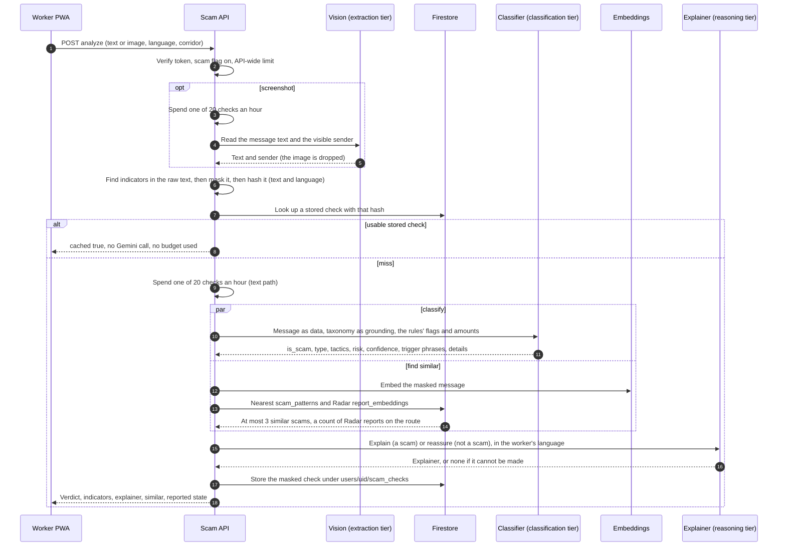

# Scam Analyzer

A migrant worker pastes a message, uploads a screenshot of it, or shares it into the app, and gets back a verdict (is it a scam, what kind, how risky), the tricks it uses, plain steps to take, and a one-tap way to warn other workers. All of it is in the worker's own language.

It is a Future Scope module. It is **off for everyone until the `scam` flag is switched on** (see "Turning it on"), it is additive to the four pillars, and it feeds Exploitation Radar when a worker chooses to report.

| | |
|---|---|
| Screens | `/scam-check` (check), `/scam-check/history` (the last 90 days), `/scam-check/history/:id` (one check) |
| API | `POST /api/v2/scam/analyze`, `GET /api/v2/scam/checks`, `GET /api/v2/scam/checks/{id}`, `POST /api/v2/scam/checks/{id}/report`. The contract is [`docs/api/v2-scam.md`](../api/v2-scam.md) and the mocks are `docs/mocks/scam/` |
| Design | [`docs/future-scope/design.md`](../future-scope/design.md) section 5 |
| Prompts | [`docs/gemini-prompts.md`](../gemini-prompts.md) |
| Built in | NF-SA-001 to NF-SA-020. Each task has a runbook in [`docs/runbooks/`](../runbooks/) named `NF-SA-0nn-*.md` |

## What a worker sees

1. **Check** (`/scam-check`): paste text (4,000 characters at most, never cut), or upload or photograph a screenshot (JPEG, PNG or WebP, 5 MB at most). On an installed Android PWA, text shared from another app (Chrome, Keep, Messages) arrives in the same box. A message is only sent when the worker taps **Check this message**, because each check can spend one of their 20 an hour. WhatsApp does not offer Share for a text message, so a WhatsApp message is copied and pasted, or sent as a screenshot.
2. **Answer**: a verdict card (risk meter, kind of scam, the words that gave it away highlighted, tricks used, contacts found with flags, similar known scams, how many workers on their route reported something like it), then the explanation (what the sender wants, three numbered steps, a **Listen to this** read-aloud button when the phone has a voice for the language). A message that is not a scam gets a short reassurance and one tip.
3. **Warn other workers**: a confirmation sheet shows exactly what would be shared (the masked text, which contacts to include, ticked by the worker) and sends an anonymous report to Radar.
4. **History**: every check of the last 90 days, newest first, 20 at a time with **Show more**.

## How a check works (as built)

What differs from the design document (`future-scope/design.md` 5.2):

- The explainer starts **after** the verdict, because it needs the verdict. The neighbour search starts first and runs beside both, and its answer is only returned to the screen, never given to the classifier, so a poisoned template or report cannot steer the verdict.
- The **indicators are found in the raw text before it is masked**, by fixed rules, with no model. Nothing in a link or number is ever fetched, opened or looked up. The classifier is told the flags and the amounts, never a link or number.
- A **screenshot always spends a check**, even if its text then matches a stored one, because the image has to be read before there is any text to look up.

### Steps and models

| Step | Does | Tier and model (`backend/app/config.py`) | Time box |
|---|---|---|---|
| Read screenshot | Transcribes the message and the visible sender | extraction, `gemini-3.5-flash-lite` | temperature 0 |
| Redact and indicators | Masks `[PHONE]`, `[EMAIL]`, `[ID]`, `[ACCOUNT]`, `[URL]`; flags links and numbers | none (fixed rules) | |
| Classify | The verdict and details | classification, `gemini-3.1-flash-lite` | temperature 0 |
| Similar scams | Embeds the message, searches 480 templates and Radar reports | embedding, `gemini-embedding-001`, 768 numbers | 8 s, and never fails a check |
| Explain a scam | Why each trick works, what the sender wants, 3 steps | reasoning, `gemini-3.5-flash`, thinking budget 256 | 20 s, then once on the classification tier; 40 s for the whole step |
| Reassure | A reassurance and one tip | classification, `gemini-3.1-flash-lite` | inside the 40 s |

The tier is named in code (`ModelTier`), the model per tier is in settings, and the rule is "the cheapest tier that passes the eval". If the explainer cannot be made the worker still gets the verdict and the answer says `explainer_status: "unavailable"` (such a check is not served from the cache, so a repeat tries again).

## Limits

| What | Limit |
|---|---|
| Pasted message | 1 to 4,000 characters after trimming. Over it is refused with 422, never cut |
| Screenshot | JPEG, PNG or WebP, 5 MB (413 above, 415 for another type); resized, read once, dropped; a long conversation read from a picture is cut to 4,000 characters after masking |
| Checks | **20 an hour per worker** that call Gemini (a repeated message is free, a screenshot always counts), plus 60 a minute API-wide. Counted per Cloud Run instance in memory (D-94, D-147) |
| Time | A message that is not a scam returns in seconds. A scam waits for the explainer (15 to 40 s, longer when Gemini is rate-limited). **The screen waits 90 s** (the contract says 60 s; 73 s has been seen on the free tier) |
| Stored checks | 90 days after the last check (TTL on `expires_at`); history pages of 20, 100 at most |
| Indicators | At most 10 per check |
| Report | At most 10 contacts, text up to 1,000 characters; one report per check |
| Reading level | Grade 6, sentences of 15 words or fewer |
| Languages | English, Hindi, Tagalog, Bahasa Indonesia, Nepali, Bengali. Routes: SG to PH, SG to IN, AU to IN, MY to ID, JP to PH, AU to PH; a worker whose route is none of the six is checked without one |

## What is stored, and what is not

- **Stored** under `users/{uid}/scam_checks/{id}`, owner-readable, backend-written: the **masked** text, the verdict, details, the explainer, the contacts found (owner-only, they may be the worker's own), and which prompt versions and taxonomy version made it. The id is the first 32 hex characters of the hash of the masked text and the language, so a repeat is one read.
- **Never stored or logged:** the image, the raw message, the hash, or a link or number outside the indicators.
- `scam_indicators/{id}` counts how often a contact was reported (written by reports, 1 year after the last report it stops being flagged). `scam_taxonomy` and `scam_patterns` are reference data written by `data-scripts/`.
- A worker cannot delete one check before the TTL (D-109).
- `scam_stats/{corridor}/weeks/{isoWeek}` holds **counts only** (checks, scams, benign, scams by type, text and screenshot, reported) per corridor and ISO week, for dashboards and the Partner API later. A Cloud Scheduler job (`scam-stats`, daily 01:30 UTC) recounts the current and previous week and replaces their documents, so it can run again at any time. Backend only; the Partner API must hide a count below 5 (D-165).
- Three Firebase Analytics events, with coarse values only (never a message): `scam_check_submitted` (`input_type`, `corridor_id`, `ui_language`), `scam_verdict_viewed`, `scam_reported`. Each is sent with the page's address cleaned of ids, query and fragment, so a stored check's id and a shared message never reach Analytics. See `docs/data-model/collections/scam.md`.

## Safety

- The message, text read from a picture and the sender are **data inside delimiters**, never part of the instructions. A closing tag inside a message is neutralised, the rules travel as the system instruction, and every prompt tells the model to ignore orders written in the message and never to reveal the rules.
- The model can only name **taxonomy ids**: a type outside it becomes `other_scam`, an unknown tactic is dropped, and a highlighted phrase must be a real piece of the message.
- A report is **anonymous by construction**: no uid, reporter hash, check id, raw message or image. The text is masked again, and only the contacts the worker ticked are included (a test fails if the uid or check id appears in the report or the log).
- Contacts and numbers are shown with flags (`shortener`, `punycode`, `lookalike`, `premium_rate`, `unexpected_country`) that are hints from fixed rules and can be wrong in both directions.

## Report to Radar

`POST /api/v2/scam/checks/{id}/report` turns a stored scam check into a Radar report about **a kind of scam**, not a business (entity type `scam_type`, slug such as `scam-illegal-recruitment-fee`). It needs a check that is the caller's and judged a scam (409 otherwise). A second report of one check returns the first (200). The report enters the Radar pipeline at the embedding step: its verdict is already structured, so the steps that validate free text are skipped.

## Errors the screen handles

413, 415 (bad image), 422 `image_unreadable` (no message could be read) and 422 `validation_failed`, 429 with `Retry-After` ("about N min"), 502 and 503 (`ai_*`, busy), 504 or the 90 s timer (took too long), offline. Only the last three offer **Try again**; nothing retries by itself because a retry spends a check.

## Evaluation

| Measure | Result | Where |
|---|---|---|
| **Golden set**: 120 invented messages, 20 per language, scam and benign look-alikes | **120 of 120 called correctly: F1 1.000 overall and in every language** (84 scams, 36 benign; bar 0.85 overall, 0.75 per language). 2026-10-07, `gemini-3.1-flash-lite`, `scam.classify v2` | [`docs/evals/scam-eval-2026-10-07.md`](../evals/scam-eval-2026-10-07.md); labels and rubric in [`docs/evals/scam-golden-set.md`](../evals/scam-golden-set.md) |
| **Stress set**: 30 harder messages (16 harmless look-alikes and 14 scams that avoid the obvious words, English and Hindi) | **30 of 30 on scam against benign, F1 1.000** (2026-10-07; one scam filed under a different type). Labels still need an independent read (D-166) | `data-scripts/evals/scam_stress_en_hi.jsonl`, [`docs/evals/scam-eval-scam_stress_en_hi-2026-10-07.md`](../evals/scam-eval-scam_stress_en_hi-2026-10-07.md) |
| **Prompt injection**: 15 messages that give orders to the analyzer, in all six languages | **15 of 15 judged on content, none echoed system prompt text** (2026-10-07, live Gemini) | [`docs/evals/scam-injection-2026-10-07.md`](../evals/scam-injection-2026-10-07.md) |
| Browser tests | 15 tests on a desktop and a phone, against the emulators and the mock API | `frontend/e2e/scam-*.spec.ts` |
| Accessibility | `axe` reports nothing serious or critical on any scam screen in six languages (jsdom); the real-device pass is by hand (D-161, D-163) | NF-SA-019 |

The bar the golden-set run enforces is F1 of scam against benign of **at least 0.85 overall and 0.75 in every language**. A perfect score on 120 invented messages is a baseline, not a guarantee: the set is small (6 to 12 messages per scam type), was written by the team and is not yet read by native speakers (D-127, D-130, D-132), and it scores the classifier only, not the explainer, the cache or the limit (D-152). It is the number to protect when a prompt changes, not a promise about real messages.

## Known limits

| | |
|---|---|
| Free-tier Gemini | The key behind production is on the free tier. The reasoning tier answers 429 or 503 at times, so explanations can be missing and a check can take over a minute. Billing on the key's project removes it. The embedding quota also stopped the pattern load (D-135) |
| `scam_patterns` not loaded in production yet | Without it a check works, but "similar scams" and the corridor report count stay empty |
| Similarity cutoff provisional | 0.85 is a first guess, not calibrated (D-141); the Radar side has none (D-143) |
| The explainer does not see the rules' flags | "This link copies mom.gov.sg" is on the card but not in the explanation (D-146) |
| Share target | Text and links only; no WhatsApp text share; a message shared while signed out is kept 10 minutes in the tab (D-153) |
| Names are not masked | A personal name in a message is still in the masked text and in a report (D-108) |
| One instance counts the limit | Up to 40 checks an hour with two instances; a restart resets it (D-94, D-147) |
| No idempotency key | A repeated tap after a dropped connection can call Gemini once more (D-126) |
| Native-speaker review pending | The Hindi, Tagalog, Indonesian, Nepali and Bengali strings, templates and golden rows (D-127 to D-139, D-154, D-157, D-159) |

The full list, with owners, is `docs/deferred-items.md`.

## Turning it on

1. **Flag**: Firestore `config/feature_flags`, field `flags.scam`: `enabled: true` for everyone, or `enabled: false` with `allow_uids` for named testers. It takes effect within 60 seconds. See `NF-F0-005-backend-feature-flags.md`.
2. **Taxonomy** (required; without it every check is a 500): from `data-scripts/`, `python -m src.loaders.scam_taxonomy` (8 types, 6 tactics, one batch, safe to repeat).
3. **Patterns** (optional): `python -m src.loaders.scam_patterns` with `GEMINI_API_KEY` set. 480 embeddings; it resumes if the quota stops it.
4. **Indexes and TTL**: the `scam_patterns` vector index and the TTL policies on `scam_checks`, `scam_indicators` and `coach_sessions` (`NF-F0-004`).
5. **Gemini key** on the Cloud Run service (Secret Manager `gemini-api-key`).

## Running the tests

| What | Command |
|---|---|
| Backend, Gemini replaced by recordings (includes 59 injection-defence tests) | `cd backend && pytest` |
| Frontend unit and screen tests against the mocks | `cd frontend && pnpm test` |
| Browser tests | `VITE_API_BASE_URL=http://127.0.0.1:4173 pnpm exec vite build --mode emulator` then `CI=true firebase emulators:exec --only auth,firestore --project demo-nomadfinance "pnpm test:e2e"` (from `frontend/`) |
| Golden-set score (120 Gemini calls) | `cd data-scripts && python -m evals.run_scam_eval --rpm 10` |
| Live injection run (about 30 calls) | `cd backend && RUN_LIVE_GEMINI=1 pytest tests/integration/api/test_scam_injection_live.py -v -s` |
| Live explainer timings | `RUN_LIVE_GEMINI=1 pytest tests/integration/api/test_scam_explain_live.py -v -s` |

Run the two live scores after any change to a scam prompt, the taxonomy or the model; see `docs/gemini-prompts.md`.

## Where things are

| | |
|---|---|
| Backend | `backend/app/api/v2/scam.py`, `scam_checks.py`; `backend/app/services/scam/` (`analyzer`, `screenshot`, `classifier`, `explainer`, `retrieval`, `indicators`, `check_store`, `history`, `report`); `backend/app/schemas/scam.py`; `backend/app/repositories/scam_*` |
| Prompts | `backend/app/prompts/scam/` |
| Frontend | `frontend/src/pages/scam/`, `frontend/src/components/scam/`, `frontend/src/hooks/useScam*.ts`, `frontend/src/services/scamService.ts`, strings in `frontend/src/i18n/scam/` |
| Data and evals | `data-scripts/data/source/scam-taxonomy/`, `scam-patterns/`; `data-scripts/evals/` |
| Data model | [`docs/data-model/collections/scam.md`](../data-model/collections/scam.md) |
| Diagram source | `docs/mermaid/scam-analyzer-pipeline.mmd` (written before the build; it still names the original model tiers) |
