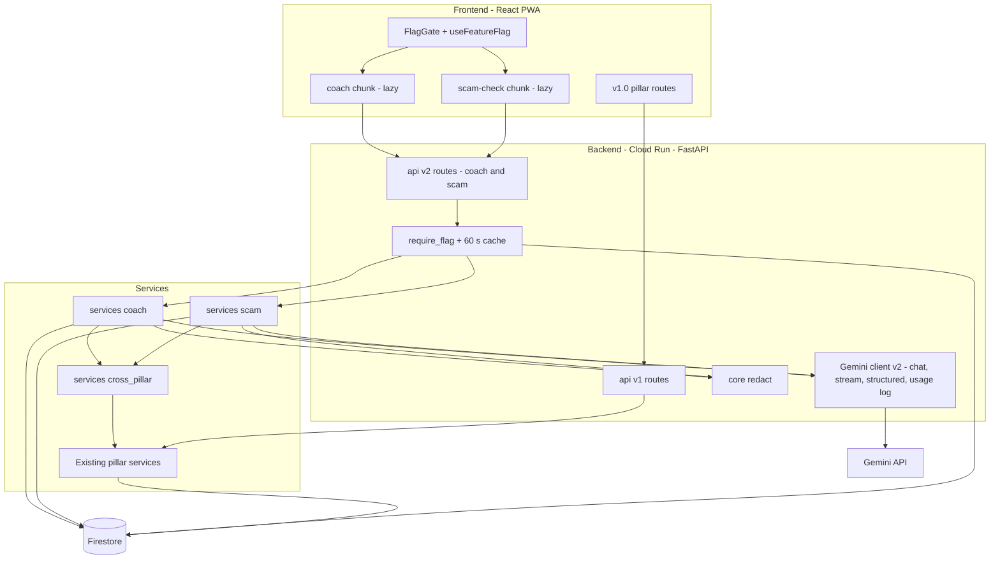
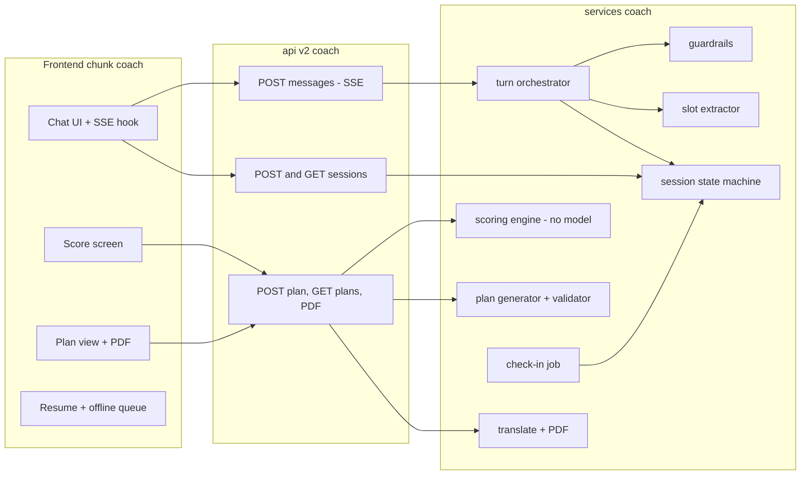
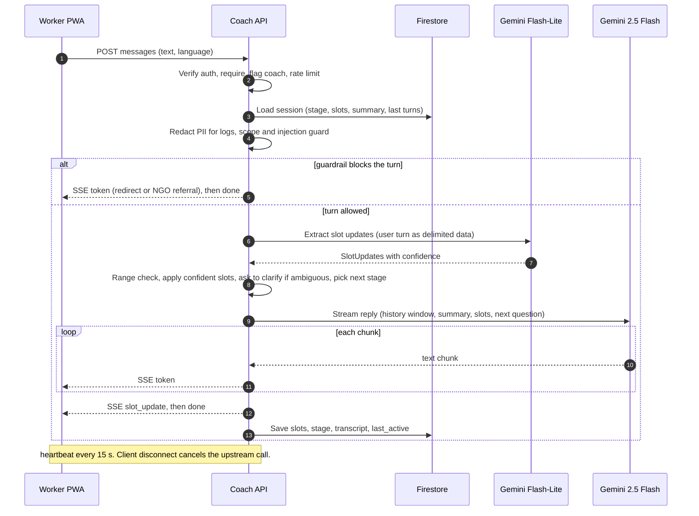
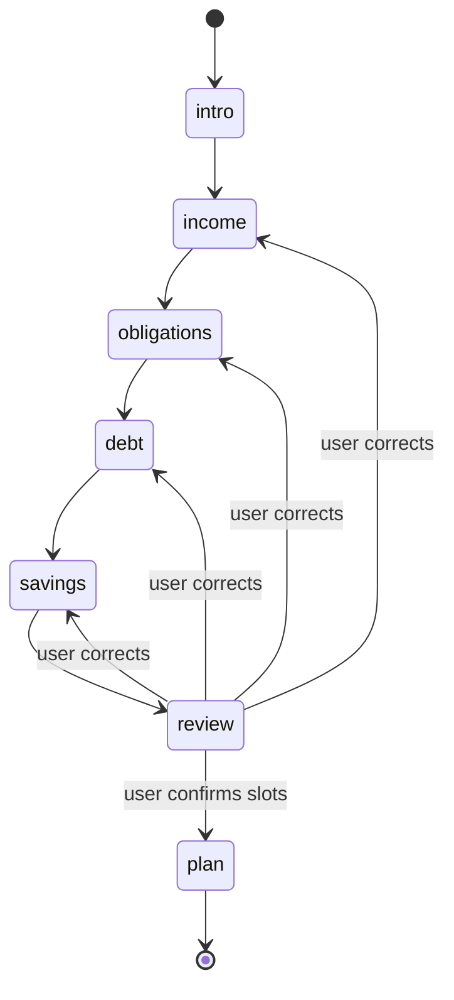
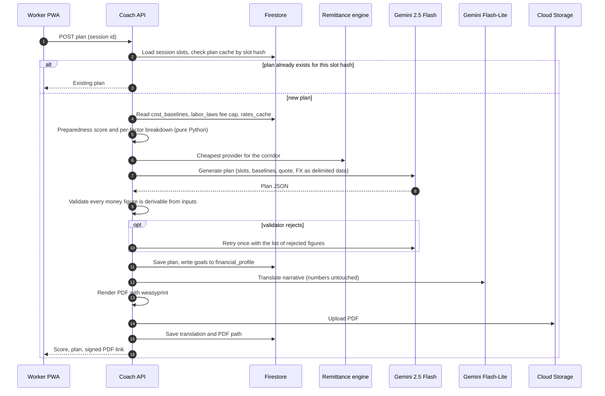
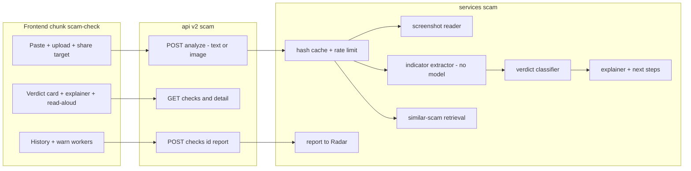
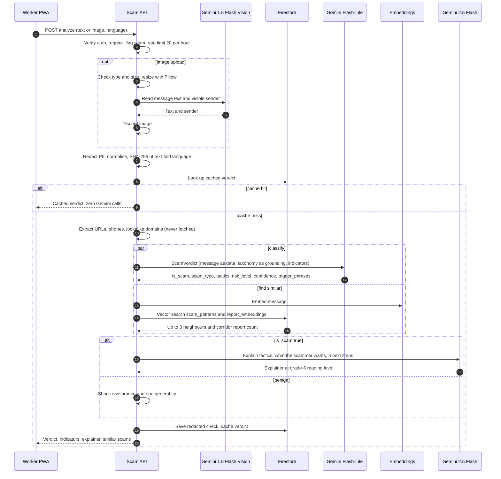
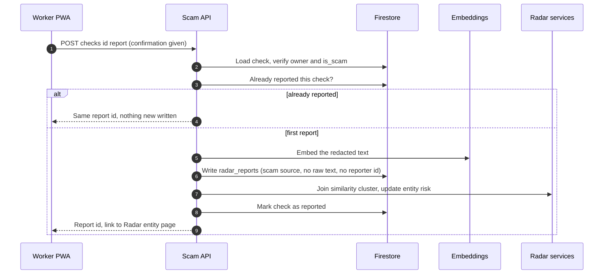

# Future Scope Technical Design Addendum

Task: NF-F0-001. Owner: Aditya. Reviewer: Devam. Status: draft for the walkthrough, 2026-10-06.

This addendum covers the two feature-flagged modules added after the v1.0 prototype: the **Pre-Departure Financial Coach** (design doc 3.1) and the **Real-Time Scam Message Analyzer** (design doc 3.3). It sits beside `docs/design-doc/NomadFinance_Design_Document.md`, does not change the four pillars' behaviour, and is the section other tasks cite (table in section 10).

How to read tags, the same convention as `docs/data-model/firestore-schema.md`:

| Tag | Meaning |
|---|---|
| **[T]** | Stated by a row of the task tracker |
| **[P]** | Proposed here because nothing else defines it. The owner of the named task may refine it but tells the team when a name changes. |
| **[built]** | Already in the repo |

Diagram sources live in `docs/mermaid/` (new: `financial-coach-pipeline.mmd`, `scam-analyzer-pipeline.mmd`; updated: `system-architecture.mmd`, `cross-pillar-data-flow.mmd` and the four pillar files). Dashed outlines in those diagrams mean "future scope, behind a flag, not deployed".

## 1. Scope and non-goals

In scope: component and sequence diagrams for both modules, model routing per step, new Firestore collections, and the touchpoints with Remittance X-Ray, Contract Shield, Exploitation Radar and Financial Identity Builder.

Not in this document, owned by other tasks: request and response schemas and the error envelope (NF-F0-002, NF-FC-002, NF-SA-002), collection field tables and sample documents (NF-F0-003), rules and indexes (NF-F0-004), the question bank (NF-FC-001), the scoring rubric (NF-FC-006) and the scam taxonomy (NF-SA-001). Where this document names a field or endpoint, it is to show the design, not to fix the contract.

## 2. Principles that apply to both modules

### 2.1 Additive and flag-gated [T]

Both modules ship dark. `config/feature_flags` holds one flag per module, `coach` and `scam`, scoped global or to a per-uid allow-list. A cached FastAPI dependency `require_flag(...)` guards every route, and a flag-off request gets `404` in the standard error envelope [T: NF-F0-005]. The frontend loads each module as its own lazy chunk, and its nav entry renders only when the flag is on [T: NF-F0-006]. With both flags off, the bundle and v1.0 behaviour are unchanged. Rollback is "flag off first".

### 2.2 API surface [T]

New routes live under `/api/v2` [T: NF-F0-002]. v1 routes are not changed. The error envelope `{code, message, request_id}`, cursor pagination, the `Idempotency-Key` header and the SSE event format are defined in NF-F0-002; this document only uses them. Streaming events are `token`, `slot_update`, `done` and `error`, with a heartbeat every 15 s [T: Streaming DoD].

### 2.3 Model tiers

Code never names a model: it asks for a tier through `ModelTier` (`app/integrations/gemini/model_tiers.py`). The tracker's labels map to tiers, and ADR-002 maps tiers to model IDs. If a model is retired, one env var changes.

| Tracker label | Tier | Model ID today (ADR-002) | Used here for |
|---|---|---|---|
| Gemini 2.5 Flash | `REASONING` | `gemini-3.5-flash` | Coach reply, plan, scam explainer |
| Gemini 1.5 Flash (extraction) | `EXTRACTION` | `gemini-3.5-flash-lite` | Screenshot reading |
| Gemini Flash-Lite | `CLASSIFICATION` | `gemini-3.1-flash-lite` | Slot extraction, verdict, translation, guardrail |
| text-embedding-004 | embedding (not a tier) | `gemini-embedding-001`, asked for 768 numbers | Scam similarity |

Every diagram in this addendum uses the tracker's labels. The embedding row is where tracker and code differ in more than a name: Firestore vectors are capped at 2048 numbers and `gemini-embedding-001` returns 3072, so `EMBEDDING_DIMENSION = 768` is used everywhere (`app/integrations/gemini/embeddings.py`), including the new `scam_patterns` index [built].

### 2.4 Gemini rules [T]

`google-genai` only. Every call that code parses uses `response_schema` from a Pydantic v2 model. Retries by tenacity, 30 s default timeout, and each call logs `feature`, `model`, `tokens_in`, `tokens_out`, `latency_ms` [T: NF-F0-007]. Prompts are versioned YAML in `backend/app/prompts/coach/` and `backend/app/prompts/scam/` (the repo convention), never inline. User text, OCR text and contract text go in as delimited data, never interpolated into instructions.

### 2.5 Data handling

- `app/core/redact.py` [T: NF-F0-008] masks phone numbers, emails, ID numbers, bank accounts and URLs before anything is logged, sent to analytics or stored from a submitted message. It is idempotent.
- Scam checks store the redacted text only. The screenshot is not persisted after text extraction [T: NF-SA-008].
- No URL taken from a submitted message is ever fetched, expanded or previewed [T: NF-SA-011].
- ADR-002 still applies: the free-tier key is acceptable for demo data only. Real worker data needs a paid-tier key before launch.
- Account deletion: `DELETE /api/v1/users/me` already removes `users/{uid}` and every subcollection, so `coach_sessions`, `coach_plans` and `scam_checks` go with it. It does **not** remove Storage files outside `contracts/`, `bills/` and `exports/`, so the coach plan PDF path must be added to `app/services/auth_service.py` when NF-FC-014 lands [P].

## 3. System context

New backend code sits beside the existing layout: routes in `app/api/v2/` [P], services in `app/services/coach/` and `app/services/scam/`, repositories in `app/repositories/`, and cross-pillar glue in `app/services/cross_pillar/` next to `contract_to_radar.py` and friends. The v2 Gemini client extends the existing wrapper rather than replacing it, so the four pillars keep passing their tests [T: NF-F0-007].

## 4. Financial Coach

A multi-turn interview in the worker's language that fills a profile, scores preparedness, and produces a 90-day plan with a PDF. Pipeline diagram: `docs/mermaid/financial-coach-pipeline.mmd`.

### 4.1 Components

Module names are [P]; task owners may rename them.

### 4.2 Interview turn (sequence)

Design choice [P]: extraction runs **before** the reply, so a clarifying question replaces a guessed value and the reply already knows the next stage. The cost is one Flash-Lite round trip before the first token, against a first-token budget of under 2 s p95 [T: NF-FC-009]. NF-FC-010 must measure it on staging. If the budget is missed, fall back to starting the reply stream at once and delivering extraction results as a `slot_update` event before `done`, accepting that a clarification then appears one turn later.

### 4.3 Session state machine

Stages are `intro → income → obligations → debt → savings → review → plan` [T: NF-FC-008]. Other rules:

- A session advances to the next stage only when that stage's required slots are filled. A worker who volunteers later-stage facts early keeps them; the stage pointer is the earliest incomplete stage, and skip logic comes from the question bank (NF-FC-001).
- Any move not in the diagram is rejected, with a unit test per transition [T].
- One active session per user [T]. Resume returns the existing session. A session idle past a limit is marked abandoned so a new one can start [P: limit in NF-F0-003].
- Every state change is saved before the reply finishes, so a server restart mid-interview resumes at the same stage [T].
- Slot-to-stage grouping [P, final in NF-FC-001]: intro takes destination, job and departure date; income takes monthly salary and currency; obligations takes dependents and remittance target; debt takes recruitment fees or debt and interest; savings takes savings and existing bank or wallet.

### 4.4 Score and plan (sequence)

Notes:

- **Scoring** is deterministic and uses no model [T: NF-FC-006, -011]. Factors: debt-to-income, months of emergency buffer, remittance-to-income ratio, recruitment fee against the legal cap, banked or unbanked. The cap comes from `labor_laws`; live FX converts to a common currency. Weights and bands are fixed in NF-FC-006, not here.
- **Plan** (`REASONING` tier) covers weeks 1 to 13: budget, remittance schedule using the cheapest provider from Remittance X-Ray, debt paydown, emergency-fund target and red-flag warnings. It may use only the slots, `cost_baselines` and live FX [T: NF-FC-012]. The validator is the control that makes this true: a figure that cannot be derived from inputs (within rounding) rejects the plan. If the retry also fails, the endpoint returns the standard "try again" failure and stores nothing.
- **Plan is generated in English**, then translated per language with the numbers excluded from the translation, mirroring how Contract Shield stores `reports/{language}`. Numeric fields must be byte-identical before and after [T: NF-FC-014].
- **Synchronous** [P]: one request, likely 20 to 40 s, like Contract Shield analysis (the clause comparison there took 20 to 33 s). The client shows a progress state. Revisit if p95 exceeds 45 s.
- **Idempotent**: the plan is keyed by a hash of the slots, so regenerate returns the same plan unless a slot changed [T].

### 4.5 Guardrails [T: NF-FC-013]

Stay on pre-departure finance and politely redirect otherwise. Treat injection attempts as data. Never recommend investment or loan products. Distress signals produce referral text to NGOs, not advice. Every plan and score carries the "not professional financial advice" note. Decisions are logged with reason codes. Rules run first and a Flash-Lite classification handles the ambiguous remainder [P], so the common case costs no extra call.

### 4.6 Check-ins [T: NF-FC-016]

A daily Cloud Scheduler job authenticates with IAM, finds plans reaching day 30, 60 or 90 after the departure date, sends an FCM push and writes a `users/{uid}/notifications` entry with a deep link to a three-question check-in. It is idempotent: one reminder per milestone per plan, recorded on the plan [P]. This follows the existing internal-job pattern (`app/api/v1/internal.py`).

### 4.7 Failure behaviour

| Failure | Behaviour |
|---|---|
| Gemini quota or unavailable | Existing mapping (`app/core/errors.py`): 503 with `Retry-After`. The session is intact; the worker retries the same turn. |
| Stream drops | Client retries and never shows a half-rendered message as final [T]. The server saves a turn only after it completes. |
| Client disconnects | The upstream Gemini call is cancelled [T]. |
| Ambiguous or out-of-range value | A clarifying question, never a guess [T: NF-FC-010]. |
| Plan validator fails twice | Error to the client, nothing stored. |

## 5. Scam Analyzer

A worker pastes a message or shares a screenshot and gets a structured verdict, an explanation of the manipulation used and safe next steps, in their language. Pipeline diagram: `docs/mermaid/scam-analyzer-pipeline.mmd`.

### 5.1 Components

### 5.2 Analyze (sequence)

Notes:

- Retrieval runs **in parallel** with classification and its results are returned to the client, not fed into the classifier prompt [P]. This keeps the verdict independent of the neighbours (a poisoned pattern cannot steer it) and keeps p95 under the 6 s budget [T: NF-SA-007]. Retrieval failure returns an empty list [T: NF-SA-010].
- The classifier treats the message as data. The adversarial suite (NF-SA-020) must show 15 of 15 injection attempts still classified on content and none echoing prompt text [T].
- The taxonomy (`scam_taxonomy`) is the grounding. Scam types start with fake job offer, illegal recruitment fee, remittance or OTP phishing, loan-app trap, embassy or authority impersonation, investment or romance, and lottery; tactics are urgency, authority, scarcity, fear, reciprocity and social proof [T: NF-SA-001].
- The explainer is skipped for benign verdicts, which also saves reasoning-tier quota.
- Cache key is the hash of the **normalised, redacted** text plus language. A repeat message costs zero Gemini calls [T: NF-SA-012]. Whether cache entries are shared across users is open (section 11).

### 5.3 Report to Exploitation Radar (sequence)

The report enters the Radar pipeline at step 5 (embedding), skipping the steps that validate free text (entity extraction, spam check, categorisation; see `exploitation-radar-pipeline.mmd`), because the verdict is already structured and a report is only possible for a check the analyzer itself marked as a scam. This is the same reasoning Contract Shield's signal uses (`contract_to_radar.py`: "no free text to spam-check"). Duplicate reports of one check return the same report [T: NF-SA-013].

### 5.4 Safety properties

- Message text, OCR text and sender are data, in delimiters, never in the instruction part of a prompt.
- URLs are extracted as strings and flagged (shorteners, punycode, lookalikes, premium-rate prefixes). Nothing makes an outbound request to them.
- The image is resized, read, and dropped. Unsupported types return `415` in the standard envelope [T: NF-SA-008].
- Rate limit 20 per hour per uid through slowapi, returned as `429` in the envelope [T].
- Stored checks hold redacted text, the structured verdict, and no image. A TTL bounds retention (section 7).

## 6. Model routing and quota

| # | Step | Module | Tier | Tracker label | Task |
|---|---|---|---|---|---|
| 1 | Guardrail ambiguity check | Coach | `CLASSIFICATION` | Flash-Lite [P] | NF-FC-013 |
| 2 | Slot extraction | Coach | `CLASSIFICATION` | Flash-Lite [P] | NF-FC-010 |
| 3 | Older-turn summary | Coach | `CLASSIFICATION` | Flash-Lite [P] | NF-FC-009 |
| 4 | Coach reply (stream) | Coach | `REASONING` | 2.5 Flash [T] | NF-FC-009 |
| 5 | Scoring | Coach | none | pure Python [T] | NF-FC-011 |
| 6 | 90-day plan | Coach | `REASONING` | 2.5 Flash [T] | NF-FC-012 |
| 7 | Plan translation | Coach | `CLASSIFICATION` | Flash-Lite [T] | NF-FC-014 |
| 8 | Screenshot reading | Scam | `EXTRACTION` | 1.5 Flash Vision [T] | NF-SA-008 |
| 9 | Indicator extraction | Scam | none | deterministic [T] | NF-SA-011 |
| 10 | Message embedding | Scam | embedding | text-embedding-004 [T] | NF-SA-006, -010 |
| 11 | Verdict | Scam | `CLASSIFICATION` | Flash-Lite [T] | NF-SA-007 |
| 12 | Explainer + next steps | Scam | `REASONING` | 2.5 Flash [T] | NF-SA-009 |

The rule is "the cheapest tier that passes the eval", re-checked against the scam golden set and the 12 coach personas [T: the prompt-change Definition of Done].

**Quota risk.** The design doc lists 500 requests a day for the reasoning tier (section 4.2; the real per-project figure is only shown in AI Studio, per ADR-002). Rows 4 and 6 and 12 all draw on it, as does Contract Shield and the FIB narrative. A rough count, with the turn count as an assumption of about 15 per interview: one coach session is about 15 replies plus 1 plan, so about 16 reasoning calls. At 500 a day that is about 31 complete sessions a day before any other feature uses the tier. This is the main capacity risk for the demo and is why NF-HR-010 includes per-feature budgets and a graceful "try again later" degrade. Mitigations to evaluate there, in order: raise the cache hit rate, shorten the history window, and move the reply to a cheaper tier if the personas still pass.

## 7. Firestore additions

Seven new collections [T: NF-F0-003]. Naming follows design doc section 4.7. Field tables, sample documents and final TTLs are NF-F0-003's job; this section fixes purpose, writer, access and the points other tasks depend on.

| Path | Holds | Written by | Client access [T: NF-F0-004] | Retention [P] |
|---|---|---|---|---|
| `users/{uid}/coach_sessions/{id}` | `stage`, slots, transcript, `last_active`, language | Backend | Owner only | TTL on `expires_at`: idle sessions expire; value set in NF-F0-003 |
| `users/{uid}/coach_plans/{id}` | Score, band, factor breakdown, plan JSON, slot hash, translations, PDF path, check-in markers | Backend only | Owner read; no client write | Kept until the user deletes the account |
| `users/{uid}/scam_checks/{id}` | Redacted text, verdict, indicators, cache key, `reported` flag | Backend | Owner only | TTL on `expires_at` |
| `scam_taxonomy/{typeOrTactic}` | Scam types and tactics: definition, tell-tale signs, safe response | Data script | Read only | None |
| `scam_patterns/{id}` | Canonical scam template, type, language, 768-number `embedding` | Data script | Backend only | None |
| `cost_baselines/{host}` | Low, typical and high monthly cost per category in local currency, each with source URL and retrieval date | Data script | Read only | None; refreshed by re-running the loader |
| `config/feature_flags` | Flags `coach`, `scam`: global value and uid allow-list | Operator | Backend only; the frontend reads it through the API | None |

Points that other tasks rely on:

- **Vector index.** `scam_patterns.embedding` needs a vector index of dimension 768, matching `report_embeddings` (already in `frontend/firestore.indexes.json` [built]). The index files are NF-F0-004's, and note the repo currently has two that differ (`frontend/firestore.indexes.json` and `infra/firebase/firestore.indexes.json`); NF-F0-004 should say which one deploys.
- **Cache location.** The hash cache can live on `scam_checks` (per user) or in a shared collection. A per-user cache needs no new collection but makes a second user's identical message cost a Gemini call. See section 11.
- **`cost_baselines` coverage.** The tracker splits the baselines across NF-FC-003 (Singapore and UAE), -004 (South Korea and Malaysia) and -005 (Japan and Hong Kong). That is six documents. See section 11 on UAE and Australia.
- **Existing collections that gain fields or values**, to be specified in NF-F0-003 and NF-SA-013 / NF-FC-015 / NF-HR-001:

| Existing | Change | Why |
|---|---|---|
| `radar_reports` | A new `source` value for scam reports (the tracker calls it `type = scam_message`) and a way to describe a scam sender, since `entity_type` allows only operator, agency and employer | Section 5.3 |
| `users/{uid}/financial_profile/current` | `goals` from the plan; optional `coach_signal` and `scam_signal` blocks; carried over on recompute like `latest_export` | Sections 4.4 and 8 |
| `users/{uid}/notifications/{id}` | New type for check-ins with a deep link | Section 4.6 |
| `users/{uid}` | Possibly an opt-in field for sharing coach and scam signals with the Financial Identity report | Section 8 |

## 8. Cross-pillar touchpoints

Diagrams: `docs/mermaid/cross-pillar-data-flow.mmd`, and the four pillar files.

| # | From | To | What flows | Mechanism | Consent | Task |
|---|---|---|---|---|---|---|
| 1 | Remittance X-Ray | Coach | Cheapest provider and quote for the corridor | In-process call to the Remittance engine, so the plan uses the same numbers the worker sees | None (no personal data leaves) | NF-FC-012 |
| 2 | Coach | Remittance X-Ray | Deep link with corridor and amount prefilled | Frontend route with query params | None | NF-FC-021 |
| 3 | Contract Shield | Coach | Latest salary and employer | Read of the user's latest analysis; shown back to the worker as a confirmation turn before use | **Worker confirms every prefill** | NF-FC-015 |
| 4 | Contract Shield (`labor_laws`) | Coach | Legal recruitment-fee cap for the score | Read of `labor_laws` | None | NF-FC-011 |
| 5 | Coach | Financial Identity | Savings rate and remittance cadence as goals | Written into `financial_profile` after plan creation | Implicit: the worker created the plan | NF-FC-015 |
| 6 | Coach | Financial Identity | Plan adherence as a signal in the narrative, PDF and activity feed | Read at recompute | **Opt-in; opt-out removes it** | NF-HR-001 |
| 7 | Scam Analyzer | Exploitation Radar | Anonymised scam report | Section 5.3 | **One tap, behind a confirmation sheet** | NF-SA-013 |
| 8 | Exploitation Radar | Scam Analyzer | "Seen N times" from `report_embeddings` | Vector search at analyze time | None (aggregate counts only) | NF-SA-010 |
| 9 | Scam Analyzer | Financial Identity | Scam-check activity as a signal | Read at recompute | **Opt-in; opt-out removes it** | NF-HR-001 |

Direction matters for two rules. First, flows into Radar are anonymised: no uid, no reporter hash that can be reversed, no raw message (the existing precedent is `contract_to_radar.py`). Second, a pillar never *depends* on a new module: with both flags off, rows 1 to 9 are inert and v1.0 behaves as it does today. Rows 1, 3, 4 and 8 are reads from the existing pillars into the new ones; rows 5 to 7 and 9 are the only writes into existing data, and each is listed in section 7.

## 9. Cross-cutting

| Concern | Decision | Task |
|---|---|---|
| Structured logs | Every request logs `feature`, `request_id` and a hashed uid; message text is never logged unredacted | NF-F0-016, -008 |
| Metrics and alerts | Log-based metrics for Gemini calls and errors per feature; alert at 80% of daily requests per model | NF-F0-016 |
| Quota guard | Per-feature daily budget with a graceful degrade, never a stack trace | NF-HR-010 |
| Rate limits | Scam 20 per hour per uid [T]. Coach limit [P]: a per-uid limit on messages per minute, value set in NF-FC-009 | NF-SA-012, NF-FC-009 |
| Idempotency | Plan by slot hash, report by check id, check-in by milestone, and `Idempotency-Key` for POSTs per NF-F0-002 | NF-F0-002 |
| Accessibility | Streamed messages announced once on completion; read-aloud for scam explainers; colour is never the only risk signal | NF-FC-023, NF-SA-017 |
| Languages | `coach` and `scam` i18n namespaces for en, hi, tl, id, ne, bn; English keys are the source of truth | NF-F0-013 |
| Testing | `FakeGemini` returning recorded responses, Firestore emulator fixtures, and an SSE mock MSW can replay | NF-F0-014 |
| Rollout | Production deploy with all flags off, then Scam Analyzer, then Coach, with a 30-minute watch each | NF-HR-011 |

## 10. Which task cites which section

| Section | Cited by |
|---|---|
| 2.1 Flags | NF-F0-005, NF-F0-006, NF-HR-011 |
| 2.2 API surface | NF-F0-002, NF-FC-002, NF-SA-002 |
| 2.3 Model tiers | NF-F0-007, NF-HR-010 and every task in section 6 |
| 2.4 Gemini rules | NF-F0-007, NF-SA-007, NF-SA-009, NF-FC-009, NF-FC-010, NF-FC-012 |
| 2.5 Data handling | NF-F0-008, NF-SA-008, NF-SA-011, NF-SA-012, NF-HR-008 |
| 3 System context | NF-F0-004, NF-F0-012, NF-HR-012 |
| 4.1 to 4.3 Coach structure | NF-FC-001, NF-FC-008, NF-FC-017, NF-FC-019 |
| 4.2 Interview turn | NF-FC-009, NF-FC-010, NF-FC-013, NF-FC-017, NF-FC-024 |
| 4.4 Score and plan | NF-FC-006, NF-FC-011, NF-FC-012, NF-FC-014, NF-FC-020, NF-FC-021 |
| 4.5 Guardrails | NF-FC-013, NF-HR-008 |
| 4.6 Check-ins | NF-FC-016, NF-FC-022 |
| 5.1 to 5.2 Analyze | NF-SA-002, NF-SA-006, NF-SA-007, NF-SA-008, NF-SA-009, NF-SA-010, NF-SA-011, NF-SA-012, NF-SA-015, NF-SA-016, NF-SA-017 |
| 5.3 Report to Radar | NF-SA-013, NF-SA-018 |
| 5.4 Safety | NF-SA-020, NF-HR-008 |
| 6 Routing and quota | NF-HR-010, NF-SA-014, NF-SA-023, NF-FC-024 |
| 7 Firestore additions | NF-F0-003, NF-F0-004, NF-SA-001, NF-FC-003, NF-FC-004, NF-FC-005, NF-HR-013 |
| 8 Cross-pillar | NF-FC-015, NF-SA-013, NF-HR-001, NF-HR-002, NF-HR-012 |
| 9 Cross-cutting | NF-F0-016, NF-F0-014, NF-F0-013 |

## 11. Open questions for the walkthrough

1. **UAE and Australia in the baselines.** The tracker's NF-FC-003 names Singapore and UAE, which is `cost_baselines/AE`. The project's scope is six host countries: SG, KR, MY, JP, HK and AU, with no UAE. As written, the tracker yields baselines for SG, AE, KR, MY, JP and HK, and none for AU. This addendum follows the tracker. Decision needed before NF-FC-003 starts: change AE to AU, or add AU.
2. **Scam report shape in Radar.** The tracker says `type = scam_message`; the existing schema has `source` (`user`, `contract_signal`, `seed`) and an `entity_type` of operator, agency or employer, none of which fits a scam sender. NF-F0-003 and NF-SA-013 decide the new value and how the sender is described.
3. **Shared or per-user scam cache.** A shared cache saves more quota and enables "reported N times" but stores one user's redacted text where another's request can hit it. The key is a hash and the value a verdict, so the leak is small, but it needs a decision (and a retention rule) in NF-SA-012.
4. **Coach reply model and quota.** Section 6 shows the reasoning tier is the bottleneck. NF-HR-010 should decide whether the reply can drop a tier once the 12 personas pass.
5. **Extraction before or after the first token.** Section 4.2. Measure first, then choose.
6. **Tracker names against repo names.** The tracker refers to `docs/api-contract.md`, `docs/data-model.md`, `backend/core/redact.py` and prompts in `backend/app/<feature>/prompts.py`. The repo has `docs/api/endpoints.md`, `docs/data-model/`, `backend/app/core/` and prompts in `backend/app/prompts/<pillar>/*.yaml`. This addendum uses the tracker's file names for the files those tasks will create and the repo's paths for code; owners of NF-F0-002, -003 and -008 confirm where each lands.
7. **Account deletion.** Plan PDFs need a path in the deletion list (section 2.5), and the Coach and Scam stores need a documented answer to "what survives account deletion". Anonymised Radar reports survive today by design.
8. **`/api/v2` layout.** A new `app/api/v2/` folder next to `app/api/v1/` is proposed in section 3; NF-F0-002 confirms.
