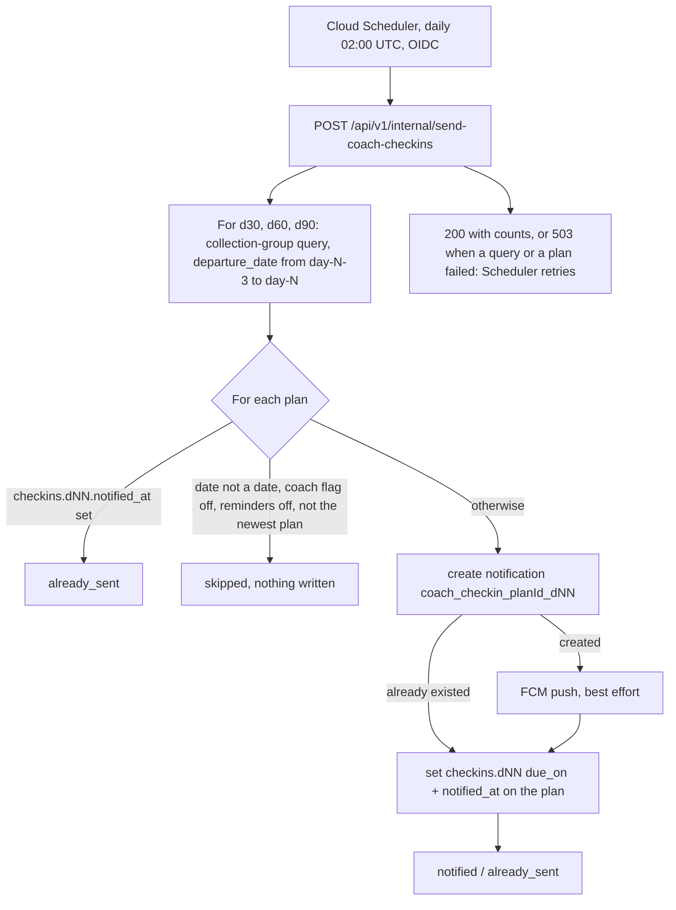

# NF-FC-016 — Coach day 30 / 60 / 90 check-in reminders

## Summary

A Cloud Scheduler job calls `POST /api/v1/internal/send-coach-checkins` once a day (02:00 UTC). The endpoint finds the Coach plans whose departure date plus 30, 60 or 90 days is today (or fell in the last 3 days). For each one it writes a `coach_checkin` notification with the deep link `/coach/checkin/{planId}?m=30` (or 60, 90) and sends an FCM push, both in the worker's `preferred_language`. It does this **once per plan per milestone, however often the job runs**.

The job only reminds. The three questions and the route that stores the answers are not part of this task (D-233); the app side of the link is NF-FC-022 (D-232). **Update (NF-FC-022, 2026-10-09):** both are now built: the route is `PUT /api/v2/coach/plans/{id}/checkins/{milestone}` and the screen is `/coach/checkin/:planId` (`docs/runbooks/NF-FC-022-coach-dashboard-widget.md`).

## Flow



**Why it can run twice safely.** The notification id is made from the plan and the milestone, and `create` fails when it exists, so of two runs only the one that created it pushes. The marker on the plan is written last: a run that fails before it is retried and finds the notification, so it marks the plan and does not push again. The cost of this order: a run that dies between the notification and the push leaves the notification without a push (never a second push).

## Files

| File | Change |
|---|---|
| `backend/app/services/coach/checkin_job.py` (new) | The job: windows, eligibility, notification, push, marker. Under `mypy --strict` |
| `backend/app/services/coach/checkin_texts.py` (new) | Title and body in the six languages, fixed (no model call) |
| `backend/app/schemas/coach_checkin.py` (new) | `SendCheckinsResponse` (counts only) |
| `backend/app/api/v1/internal.py` | The endpoint, next to the other cron endpoints |
| `backend/app/repositories/coach_session_repo.py` | `CoachPlanRepository.departing_between` (collection-group range query, fetches only `departure_date` and `checkins`) and `mark_checkin` (field paths) |
| `backend/app/repositories/user_repo.py` | `create_notification_once` (fixed id, `False` if it exists) |
| `backend/app/integrations/firebase_messaging.py`, `backend/app/services/radar/notify.py` | `usable_tokens` moved from Radar's notify module so both pushes share it; Radar behaves as before (its tests are unchanged and pass) |
| `backend/app/core/features.py` | The job counts as the `coach` feature in logs and metrics |
| `infra/cloud-scheduler/coach-checkins.yaml` (new) | The Scheduler job; `scheduler-deploy.yml` creates it when the file is merged |
| `backend/tests/...` | `unit/services/test_coach_checkins.py` (60), `integration/api/test_internal_send_coach_checkins.py` (9), `integration/repositories/test_coach_checkins.py` (7, emulator), `fixtures/coach_checkins.py`, one row in `unit/core/test_features.py` |
| `docs/api/endpoints.md`, `docs/api/v2-coach.md`, `docs/data-model/collections/coach.md`, `docs/data-model/firestore-schema.md`, `infra/README.md` | The endpoint section; open point 4; `checkins` (written by the job, absent at plan creation) and the range query; the job list; D-230 to D-235 |

No shared file (requirements, `pyproject.toml`, `package.json`, Dockerfile, rules, workflows, `firebase.json`, `tsconfig*`, `.gitignore`) was touched, and no new dependency. The index on `coach_plans.departure_date` (collection-group scope) already exists in `frontend/firestore.indexes.json` (NF-F0-006, D-114).

## Choices that were not in the task text

| # | Point | What was done |
|---|---|---|
| 1 | Path | `/api/v1/internal/`, not `/api/v2`. Design 4.6 says to follow `internal.py`, the scam-stats cron (NF-SA-022) is there too, and the rate-limit exemption and the auth-matrix test cover only that prefix. `/api/v2` stays for worker-facing coach routes |
| 2 | Catch-up | A plan is picked up on its day and for the 3 days after (`CATCH_UP_DAYS`), so one skipped run delays a reminder and never loses it. The docs said `departure_date ==`; they now say a range. The job must therefore run at least every 3 days |
| 3 | Newest plan only | A changed answer makes a new plan and the old one stays in storage. Without this rule a worker who moved their departure date would still get "30 days since you left" for the old date |
| 4 | Fixed words | Wording in code for six languages, like `guard_texts.py`: no cost, no way to fail, same text every run. hi, tl, id, ne and bn are team-written, not read by native speakers (D-230) |
| 5 | Preference | `notification_prefs.reminders == false` skips the notification and the push (users.md: a `coach_checkin` follows `reminders`). The profile page already has the switch |
| 6 | Flag | The `coach` flag is checked per worker (it has an allow-list). A worker without it is skipped with nothing written, and still gets the reminder if the flag turns on inside the 3 days |
| 7 | Status | 503 when a query or a plan failed, so Scheduler retries (safe: the job is idempotent). Radar's cron answers 200 always because a retry there re-spends Gemini calls; here a retry costs nothing |
| 8 | Marker | The plan has no `checkins` when it is made (NF-FC-012 did not write it, and is merged). The job writes `due_on` and `notified_at` by field path. The data-model example said `notified_at: null` at the start; it now shows the state after day 30 |
| 9 | Time of day | 02:00 UTC is 10:00 to 13:00 on the same calendar date in all six host countries (UTC+8 to +11), so "today" is the worker's today |
| 10 | Answers | Not built (D-233). Contract open point 4 now says what is done and what is open |
| 11 | Shared token filter | `usable_tokens` moved out of Radar's notify module instead of being copied (a 6-line change in Radar, behaviour and tests unchanged) |

## Results

**Offline (2026-10-09):** 3,302 backend tests pass, 181 skipped (the live ones and the 7 emulator ones), **1 fails: `test_coach_question_bank.py::TestTheFile::test_the_file_is_utf8_json_with_a_final_newline` (D-181, line endings on a Windows checkout; a file this task did not touch)**. 77 are new.

| Check | Result |
|---|---|
| Dates | The window is the day and the 3 days before it; the windows of the three milestones never overlap; day 29 and day 34 send nothing; a run on day 33 still sends the day 30 reminder, with `due_on` of day 30 |
| Once per milestone (in memory) | The job run every day from day -3 to day 107 writes exactly 3 notifications, on days 30, 60 and 90, and the markers say `2026-12-31`, `2027-01-30`, `2027-03-01` for a departure on `2026-12-01` |
| Idempotent | Two runs on one day send once; **two runs started at the same moment push once**; a marker write that fails (503) is retried without a second push |
| Who is left out | Flag off (nothing written, sent later if it turns on in time), `reminders` false, an older plan, no departure date, a departure date that is not a date |
| The push | No token, junk tokens, a push that raises, a token FCM calls gone (removed), a token cleanup that fails: the notification and the marker are always written |
| Words | All six languages, the day in digits 0 to 9, short, in the right script, English for a missing or odd language |
| Endpoint | 200 with counts only (no uid, no plan id); 503 when a write fails; 401 no token; 401 bad token; 403 another Google identity or an unverified email; not in the OpenAPI document. The existing auth-matrix test also picked the new route up and passed |
| **Time-travel on the Firestore emulator** | Real repositories, 6 workers, the job run **twice a day** from day -3 to day 107: exactly 6 reminders (u1 on days 30, 60, 90; u3, who moved their date 15 days later, on days 45, 75, 105), 6 pushes, none for reminders-off, no date, a far-off date or no flag; each notification has the right id, type, language, deep link and time; the stored plan is otherwise unchanged. **Pass** |
| Emulator repositories | The collection-group query returns every worker's plans in the range, with only the fields the job needs, and skips another parent's `coach_plans`; a marker keeps an answer stored beside it; a notification id is taken once; of 8 creates at once exactly one wins |
| Emulator route | The route with the real repositories and the real flag reader (allow-list honoured): 200, one reminder, the second call sends nothing. **Pass** |
| Coverage of the new modules | `checkin_job.py` 100%, `checkin_texts.py` 100% |
| One deliberate break | Pushing even when the notification already existed: the same-moment test and the retry test fail (2 of 69). Other breaks were not tried |
| `black`, `ruff`, `mypy app`, `mypy --strict app/services` | clean |

**Seen on the emulator:** with 8 creates of one id at once, the losers get `Aborted: Transaction lock timeout` instead of `AlreadyExists`. The job treats it as a failed plan (503), the retry finds the notification and does not push again. The test accepts both answers.

**Not verified:** a real push to a real device (nothing was sent to FCM; `send_push` is replaced in every test); the job in production (D-231); the wording by native speakers (D-230); a tap on the reminder opening anything (NF-FC-022, D-232); a Cloud Run revision with the new route (the Scheduler job and the backend deploy are separate workflows).

## Manual test

From `backend/` with its virtual environment active.

```bash
# 1. the free tests: the job, the words, the endpoint, the auth matrix, the feature mapping
python -m pytest tests/unit/services/test_coach_checkins.py tests/integration/api/test_internal_send_coach_checkins.py tests/integration/api/test_auth_matrix.py tests/unit/core/test_features.py -q
```

Expect all to pass (69 of them are the first two files).

**The time-travel test on the Firestore emulator** (needs Java and the Firebase CLI). From `frontend/`, bash:

```bash
export FIREBASE_PROJECT_ID=demo-nomadfinance GOOGLE_CLOUD_PROJECT=demo-nomadfinance
firebase emulators:exec --only firestore --project demo-nomadfinance "cd ../backend && .venv/Scripts/python.exe -m pytest tests/integration/repositories/test_coach_checkins.py -v"
```

PowerShell:

```powershell
$env:FIREBASE_PROJECT_ID = "demo-nomadfinance"; $env:GOOGLE_CLOUD_PROJECT = "demo-nomadfinance"
firebase emulators:exec --only firestore --project demo-nomadfinance "cd ..\backend && .venv\Scripts\python.exe -m pytest tests/integration/repositories/test_coach_checkins.py -v"
```

Expect `7 passed`. **On Windows the emulator's `java.exe` keeps running after `emulators:exec` ends** and holds port 8085, so the next run says "port taken". Stop it: `Get-NetTCPConnection -LocalPort 8085 -State Listen | ForEach-Object { Stop-Process -Id $_.OwningProcess }` (PowerShell), or `taskkill //PID <pid> //F` from the PID that `netstat -ano | grep :8085` shows (bash).

**In a real project** (after the PR is merged and deployed; D-231). The test worker's `coach` flag must be on in `config/feature_flags`.

1. In the Firestore console, open a test worker's plan under `users/{uid}/coach_plans/{planId}` and set `departure_date` to the date 30 days ago (`YYYY-MM-DD`). Make sure the worker's profile has `fcm_tokens` if you want a push, and `notification_prefs.reminders` is not `false`.
2. Run the job (bash and PowerShell are the same):

```bash
gcloud scheduler jobs run coach-checkins --project nomadfinance-prod --location asia-south1
gcloud logging read 'resource.type="cloud_run_revision" AND "coach_checkins day="' --project nomadfinance-prod --limit 3 --freshness 1h
```

3. Expect the log line `found=1 notified=1`; `users/{uid}/notifications/coach_checkin_{planId}_d30` with `deep_link` `/coach/checkin/{planId}?m=30`; and `checkins.d30` (`due_on`, `notified_at`) on the plan.
4. Run it again: `notified=0 already_sent=1`, nothing new. To repeat the test, delete the notification and the `checkins.d30` field.

## Troubleshooting

| Symptom | Cause / fix |
|---|---|
| The run answers 503 and the log has `coach_checkin_query_failed` | The collection-group index on `coach_plans.departure_date` is missing in that project (D-114, `docs/data-model/firestore-schema.md`). Make it in the console, then run again |
| `found=N` but `skipped=N` | The `coach` flag is off for those workers, or `reminders` is `false`, or the plan is not their newest. The log line lists the reasons |
| `notified=1` but no push arrives | The profile has no usable `fcm_tokens`, or the log has `coach_checkin_push_failed`. The in-app notification is written either way |
| A reminder did not go out on day 30 | The run on days 30 to 33 all failed or the flag was off the whole time; a plan is not picked up after day 33 |

## Rollback

Switch the `coach` flag off first: the job then sends nothing and writes nothing (it still runs its three small queries). To stop the job itself: `gcloud scheduler jobs pause coach-checkins --project nomadfinance-prod --location asia-south1`. Removing the YAML does not delete the job (the workflow only creates and updates); delete it with `gcloud scheduler jobs delete`. Reminders already written stay in the workers' feeds. Reverting the PR needs no data change.

## Definition of Done

**Backend Endpoint: `/internal/send-coach-checkins`**
- [x] Endpoint defined in FastAPI with a Pydantic response model (no request body, like the other cron endpoints)
- [x] Auth: Cloud Scheduler OIDC only (the shared dependency); marked internal, hidden from `/docs`
- [x] Structured logging (`coach_checkins` summary line; `coach_checkin_failed` with a hashed user id; push and cleanup warnings with no token in them)
- [x] Error handling: 401, 403, 503 (internal auth not configured, or a query or plan failed)
- [ ] Manual test via Swagger: not run (hidden from `/docs` by design; no real push was sent). Covered instead by the route test on the emulator and the steps above
- [x] `docs/api/endpoints.md` updated (`docs/api/v2-coach.md` open point 4)
- [x] Rate limiting: exempt by design, like every `/internal/*` endpoint

**Firestore data (no schema change; a field the model already listed)**
- [x] `docs/data-model` updated (`checkins`, the range query)
- [x] Emulator tests pass (7)
- [x] No rules or index change needed

**Feature-flagged module (backend part)**
- [x] Flag off: no worker without the flag gets a notification or a push (tested; the job is not a user route, so there is no 404 to return)
- [x] v1.0 behaviour unchanged: Radar's push path was touched only to share `usable_tokens`, and its tests pass
- [ ] Own lazy-loaded chunk: not applicable (no frontend in this task)
- [x] Rollback path stated (above, and in the PR)

## Commit and PR

Branch: `feature/NF-FC-016-coach-checkin-reminders` (already checked out).

Commit message:

```
feat(coach): add day 30, 60 and 90 check-in reminders
Refs: NF-FC-016
```
