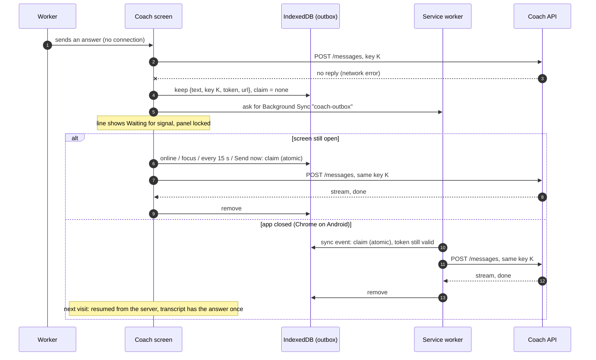

# NF-FC-019 — Coach session resume, drafts and offline answer queue

## Summary

Three additions to the Coach screen (`/coach`, built by NF-FC-017 and -018):

| What | Where | How it behaves |
|---|---|---|
| **Resume banner** | Top of the screen, when the worker comes back to an interview that is under way | "Welcome back. Step 4 of 6: Debt. You last answered 2 hours ago. Your answers are saved." with **Continue** and **Start a new interview** (which asks first, since the answers go with it). It goes at the worker's first answer. Not shown for a new interview or once the answers are confirmed |
| **Drafts** | The answer box, and the amount, number, rate and date helpers | What was typed and not sent comes back after a reload or a killed tab, with the answer box open if it was open. Kept per person, per interview and per question; removed when the answer is sent, on restart and on sign-out |
| **Offline queue** | The conversation | An answer that gets no reply because there is no connection is kept on the phone, shown as **Waiting for signal**, and sent once, with the same `Idempotency-Key`, when the connection returns. With the app closed, a service worker sends it (Chrome on Android). The panel is locked while an answer waits |

The tracker's finish line: kill the tab mid-interview and resume at the same stage; an airplane-mode message is delivered on reconnect exactly once. Both are covered by tests and were tried in a real browser (below).

No backend change, no new route, no new dependency, and none of the project's shared files (`package.json`, lock file, `firebase.json`, rules, workflows, `tsconfig*`) was touched. `vite.config.ts` has one line added (below).

## What the worker sees

| State | Screen |
|---|---|
| Coming back | The banner above the step row. Buttons are 44 px high |
| Typed, then reloaded | The box is open again with the words in it; a helper has its amount, currency and period back |
| Sent with no connection | The worker's line, with a clock and **Waiting for signal** under it. In the conversation, a quiet notice: "No connection. Your answer is saved on this phone and will be sent when you are back online." with **Send now**. The answer panel is locked. No red alert, no "Not sent": nothing is wrong with the answer |
| Connection back | The answer goes by itself; the coach's reply streams in as usual; the notice and the clock disappear; the panel opens |
| Reload, or tab killed, while an answer waits | The line comes back as waiting and goes when the screen opens online |
| The server refused a waiting answer for good (the interview ended) | "Not sent" with the reason and **Start a new interview** |

## Flow



**Why the answer goes out exactly once.** The server runs a turn once per `Idempotency-Key` and replays a finished one, but only the **latest** turn (`docs/api/v2-coach.md`). So: the key is made when the answer is first sent and kept with it; one answer waits at a time and the panel is locked, so no other turn can come in between; the page and the service worker take the answer with one atomic read-and-write in IndexedDB (a 90-second lease), so they never both send; and an answer the server already saved (its `turn_count` is higher than when it was queued) is dropped, not sent again.

## Files

| File | What it does |
|---|---|
| `src/utils/coachOutbox.ts` (new) | The rules, with no I/O: which failures are kept, the entry, the lease, the token's expiry, "already saved" |
| `src/utils/coachStorageKeys.ts` (new) | The names of what is kept on the phone, in a tiny module so sign-out can wipe them without the Coach's code |
| `src/lib/coachOutboxStore.ts` (new) | IndexedDB (memory where it is missing or refuses), the atomic claim, installing the worker and asking for Background Sync |
| `public/coach-outbox-sw.js` (new) | The service worker: on `sync`, sends the waiting answer with the saved token; marks a refusal for the screen; asks the browser to retry otherwise |
| `src/services/coachOutboxService.ts` (new) | Keeps an answer with its token and the full address, and asks for the sync |
| `src/hooks/useCoachChat.ts` | Keeps an answer that got no reply, sends it again on `online`, focus, every 15 s or Send now, restores one left by an earlier visit, never waits more than 3 s for storage |
| `src/utils/coachChatState.ts` | `queued` on the state and the line; actions `queued` and `restored` |
| `src/components/coach/OfflineNotice.tsx`, `ResumeBanner.tsx` (new) | The notice and the banner |
| `src/components/coach/CoachChat.tsx`, `ChatLog.tsx`, `components/common/ChatBubble.tsx` | Wiring: the banner, the notice in the conversation, the locked panel, the waiting marker on the bubble (a new optional prop), clearing the draft on send and the answer on restart |
| `src/utils/coachDraft.ts`, `src/hooks/useCoachDraft.ts` (new) | The draft in `localStorage`, and a context that works without a provider |
| `src/components/coach/TextComposer.tsx`, `MoneyField.tsx`, `SimpleFields.tsx`, `AnswerPanel.tsx` | Their text fields come from the draft |
| `src/utils/relativeTime.ts` (new) | "2 hours ago" in the worker's language, from the browser's locale data |
| `src/lib/coachLocalData.ts` (new), `src/services/authService.ts` | `signOut` wipes drafts and the outbox first |
| `src/services/apiClient.ts` | `apiUrl(path)`: the full address, for the worker (it has no build settings) |
| `src/utils/coachErrors.ts` | Firebase's "no network" error (an expired token, offline) is `network`, as a request that never arrived |
| `src/mocks/fakeIndexedDb.ts` (new, tests only) | A small IndexedDB stand-in that runs one transaction at a time, as a browser does |
| `src/i18n/coach/{en,hi,tl,id,ne,bn}.json` | 10 keys each: `resume.*` (7) and `offline.*` (3) |
| `vite.config.ts` | One line: `"coach-outbox-sw.js"` added to `globIgnores` (below) |
| `docs/api/v2-coach.md` | A status line and a client rule; D-112 revisited, D-240 to D-243 |
| Tests (9 new files, 3 extended; 123 new tests) | Below |

Not touched: `package.json`, the lock file, `tsconfig*`, the router, `firebase.json`, the rules, workflows, and everything in `backend/`.

The one line in `vite.config.ts` (not on the list of shared files; the diff was shown before it was made):

```diff
-        globIgnores: ["firebase-messaging-sw.js", "splash/**"],
+        globIgnores: ["firebase-messaging-sw.js", "coach-outbox-sw.js", "splash/**"],
```

Without it the app's own service worker would precache the new one (`globPatterns` takes every `.js` in `dist`), and a worker script must never be precached by another: the browser's own update check for it would be served a stale copy.

## Firebase, Firestore and Google Cloud checked for this task

| Where | Finding | Change |
|---|---|---|
| `frontend/firebase.json`, hosting | `Cache-Control: no-cache` on `**`, so `/coach-outbox-sw.js` is revalidated on every load, which is what a service worker needs. The `**` rewrite to `index.html` does not catch a file that exists. No `Service-Worker-Allowed` header is needed: the scope is below the script's folder | None |
| `firestore.rules`, `storage.rules`, `firestore.indexes.json` | Sessions are written by the backend; the chat uses the API and never reads Firestore. The frontend's Firestore SDK has no offline persistence turned on, so there is nothing of Firestore's to build on | None |
| Backend CORS (`backend/app/main.py`) | Allows `Authorization`, `Content-Type`, `X-Request-ID` and `Idempotency-Key`, which are the headers the worker sends. The worker's origin is the site's | None |
| App Check | Only radar enforces it; the coach routes do not, so the worker needs no App Check token | None |
| Firebase Auth | Persistence is IndexedDB, so a worker stays signed in offline. The ID token lasts an hour, and offline `getIdToken()` throws once it has lapsed: that is why the token is saved with the answer, and why a lapsed one is left to the screen | Error mapping only (`coachErrors.ts`) |
| Environment variables | None added | None |
| Hosting needs HTTPS for service workers and Background Sync | Firebase Hosting and `localhost` are | None |

## Choices that were not in the task text

| # | Point | What was done |
|---|---|---|
| 1 | One waiting answer | The coach's next question depends on the answer, and the server replays only the latest turn for a key. The panel is locked while an answer waits |
| 2 | No cancel or edit | A request that failed on the network may still have reached the server, so cancelling could hide a saved answer. The worker can correct it at the review step |
| 3 | Only an answer is kept | A turn without text is the coach speaking (the opening, a language switch); a failed one shows the usual "try again" |
| 4 | Service worker with a saved token | The worker has no Firebase login. The answer carries the ID token (up to an hour); with a lapsed one the screen sends it when it opens. Wiped on delivery, restart and sign-out |
| 5 | The service worker has its own scope | Like the push worker (`lib/messaging.ts`): the app's worker owns `/`, and this one only needs waking. Installed when the Coach screen opens, while there is a connection |
| 6 | Atomic claim with a lease | Page and worker take the answer in one IndexedDB transaction; a holder gone for 90 seconds (the server's own limit for a running turn) loses it |
| 7 | "Online" is not trusted | A connection that is "up" but carries nothing is common on a phone, so while an answer waits the screen also tries every 15 seconds when visible, and offers Send now |
| 8 | Not a failure | The waiting state has its own look (a clock, a status, no red); a refusal for good is a failure and looks like one |
| 9 | Drafts keyed by question | One draft per person, for one question of one interview; a new question starts empty. The helper fields reset on a new question |
| 10 | Sent clears the whole draft | Including that the box was open, so a question already answered leaves nothing behind |
| 11 | Storage never blocks the screen | IndexedDB that fails falls back to memory; one that neither answers nor fails is given up on after 3 seconds, so the panel is never locked by it |
| 12 | The banner waits for the look at the phone's storage | It appears a moment after the chat (D-242) instead of flashing and then going when an answer is waiting |
| 13 | Cold open with no signal is out | `useFeatureFlags` fails closed, so the Coach flag reads off without a connection (D-241) |

## Results (2026-10-09)

| Check | Result |
|---|---|
| `eslint --max-warnings 0`, `node scripts/check-i18n.mjs` | clean (1,069 English keys, 10 of them new) |
| `prettier --check` on the changed and new files | clean (CRLF files checked with `--end-of-line crlf`; the whole-repo check reports every file on this checkout) |
| `tsc -b` | clean for everything except the 4 errors in `src/mocks/axe.ts` (`axe-core` is not installed on this machine; they were there before) |
| `vitest run src` | **1116 passed** in 100 files. Three suites that import `axe-core` cannot load here (`axe.test.tsx`, `scamParts.a11y.test.tsx`, `scamPages.a11y.test.tsx`), as before |
| New tests | **123**: pure rules 14, draft rules 9, relative time 5, reducer 6, errors 2, storage layer 23 (each rule on memory and on the IndexedDB stand-in), service worker script 24, sign-out wipe 3, the chat offline 18, resume and drafts 17, the page 2 |
| Tests shown to fail when the code is broken | The worker with the removal after delivery, the idempotency header and the lease check each broken: 2, 1 and 2 tests fail. The queue rule and the claim rule broken: 9 and 6 tests fail. All restored, green |
| Coverage of the new and changed files | 93.6 to 100% of lines in every one (lowest: `useCoachChat` 93.6%, `coachOutboxStore` 95.7%, `MoneyField` 96%). Whole frontend 46.8% |
| `vite build` | passes. `CoachHome` chunk **43.9 KB (14.75 KB gzip)**, was 28.7 KB (9.7 KB); `CoachRoute` 0.8 KB; main chunk 582.5 KB, unchanged apart from two storage names (for the sign-out wipe). `coach-outbox-sw.js` is 6.4 KB in `dist` and **not** in the precache list |

**The browser check** (a throwaway page with the real `CoachChat` and a stubbed network, plus a stub API for the real worker, both deleted afterwards), at **360 x 740**:

| Measured | Result |
|---|---|
| The banner, light, dark and in Hindi | Renders as described; "2 घंटे पहले" comes from the browser's own Hindi data. No sideways scroll (page width 360) |
| Typed text, then a reload | The box is open again with the words; the draft is gone once the answer is sent |
| An answer sent with the network down | The line, "Waiting for signal", the notice and Send now; the panel locked; the answer in IndexedDB with its token (59 minutes left) and no claim |
| A reload while an answer waits, then online | The page found it and sent it **once**, with the same key; the reply streamed in; the entry is gone; an extra `online` event sent nothing more |
| The real worker, in a real worker, with real IndexedDB and CORS | One POST to the stub with `Authorization: Bearer <saved token>`, the same `Idempotency-Key`, `Accept: text/event-stream` and the body `{text, language}`; the entry removed; a second flush sent nothing |
| The browser pane's Background Sync | **Switched off** ("Background Sync is disabled"): the screen kept working with no error, which is the fallback. The `sync` event itself was therefore not fired (D-242, point 5): the worker was asked to flush by a message instead |
| Buttons | **Continue**, **Start a new interview** and **Send now** are 44 px high (measured); the two confirm buttons use the same class |

**Not verified:** the real `sync` event on an Android phone (Chrome); a real backend turn (the replies came from the recorded streams and a stub); a screen reader on the new notice and banner; Slow 3G in DevTools; Playwright (NF-FC-025).

## Manual test

**1. The tests, no backend** (from `frontend/`; PowerShell and bash are the same; `npx vitest run` instead of `pnpm exec vitest run` if `pnpm` will not start):

```bash
pnpm exec vitest run src/utils/coachOutbox src/utils/relativeTime src/utils/coachDraft src/utils/coachChatState src/utils/coachErrors src/lib/coachOutboxStore src/lib/coachOutboxSw src/lib/coachLocalData src/services/authService.signOut src/components/coach src/pages/coach
```

Expect `239 passed` in 19 files.

**2. The real app.** Start the emulators, the API and the dev server as in `NF-F0-005-backend-feature-flags.md`, sign in, put the test user's uid in `flags.coach.allow_uids` and wait a minute. The backend needs a `GEMINI_API_KEY` in `backend/.env.local` for real replies. Open `http://localhost:5173/coach` and answer two or three questions.

1. **Resume.** Reload the page. The banner says the step and how long ago. **Continue** hides it. Reload again, tap **Start a new interview**: it asks first; **No, keep going** brings the banner back; **Yes, start over** opens a new interview.
2. **Drafts.** Tap **Type my own answer**, type a sentence, reload: the box is open with the sentence. On a money question type `4200`, choose another currency and **Per week**, reload: all three are back. Send an answer: reload, nothing of it comes back.
3. **Offline queue.** DevTools → Network → **Offline** (on a phone: airplane mode). Tap a chip: the line shows **Waiting for signal**, the notice appears, the chips are greyed. Set **No throttling**: the answer goes, the reply streams in, the notice goes. In the Network tab there is **one** successful `messages` request; reload and the transcript holds the answer once.
4. **Tab killed while waiting.** Offline, tap a chip, close the tab, go online, open `/coach` again: the answer is sent as the screen opens (or was already sent by the service worker on Chrome for Android). The transcript holds it once.
5. **Service worker.** DevTools → Application → Service Workers: `coach-outbox-sw.js` on scope `/coach-outbox-scope`. Application → IndexedDB → `nomadfinance-coach-outbox` → `entries` shows the waiting answer. With an answer waiting and the tab closed, **Sync** with the tag `coach-outbox` runs the worker's delivery.
6. **Sign-out wipe.** With an answer waiting and a draft typed, sign out: the `nomadfinance-coach-outbox` database and the `nomadfinance.coach.draft.<uid>` key are gone.
7. **Slow 3G** and **360 px** (the device toolbar): the screen opens, nothing scrolls sideways, the banner and the notice fit.
8. **Keyboard.** Tab to **Continue**, **Start a new interview** and **Send now**; each works with Enter.

## Troubleshooting

| Symptom | Cause / fix |
|---|---|
| "No connection" stays after the connection is back | The device says it is online but the API is not reachable (a login page, a blocked address). The screen tries every 15 seconds while visible, and **Send now** tries at once. Check `VITE_API_BASE_URL` and CORS |
| The banner is missing after a reload | The interview is new (no answers yet), or its answers are confirmed (stage `plan`), or an answer is waiting (the notice says it instead) |
| The draft is not restored | The question changed, the interview was restarted, the draft is older than 14 days, or storage is blocked in a private window |
| The worker never sends with the app closed | Background Sync exists in Chrome on Android only; the token may have lapsed (over an hour); or the browser has it off (this pane does). The screen sends the answer when the app next opens |
| `ServiceWorker script evaluation failed` for `coach-outbox-sw.js` | A syntax error in the plain script (no bundler checks it): `src/lib/coachOutboxSw.test.ts` loads the real file and fails first |
| Two requests with the same key in the Network tab | The first had no reply, the second is the retry: the server runs the turn once |

## Rollback

Switch the `coach` flag off first (`config/feature_flags`, `flags.coach.enabled` false, and no uid in `allow_uids`): `/coach` redirects to the dashboard, and the screen, the worker and its storage are never touched for anyone. Reverting the PR is safe: it changes no data and no backend. After a revert, the drafts and any waiting answer already on a phone are no longer read, and sign-out no longer wipes them; the token in a waiting answer lapses within the hour. The worker script is a static file that nothing registers once the Coach screen is gone; a phone that has it registered keeps an idle worker until the browser removes it.

## Definition of Done

**Frontend Feature**
- [x] Built with Tailwind and the shared UI kit (`Button`, the chat bubble, the same cards as the notice)
- [x] Mobile responsive: checked at 360 x 740 in the browser pane (light, dark, Hindi)
- [ ] Slow network (3G throttled in DevTools): the retries and limits are tested; the throttled run is manual step 7
- [x] Loading states: the screen is locked, with the typing dots while an answer is sent; storage never holds it up
- [x] Error states: offline (waiting), a refusal for good (not sent, with the reason), a lapsed token, storage that fails or hangs
- [x] i18n keys in all 6 languages (`check-i18n.mjs` clean); native reading is D-240
- [ ] Screenshots in the PR (take them from the manual test: the banner, and the waiting state with its notice)
- [x] Accessibility, partly: real buttons and labels, the banner is a named region, the notice is a status that does not take focus, the waiting marker is text. `axe` was not run (not installed here, D-238) and no screen reader was used
- [ ] Reviewed by a teammate

**Streaming (SSE) endpoint (the client's part)**
- [x] A turn that got no reply is kept and sent again with the same `Idempotency-Key` (tested; the server's replay is the contract's)
- [x] Closing the screen mid-send lets go of the answer, so the next visit or the worker need not wait out the lease (tested)
- [x] A half reply is never shown as final (unchanged)

**Feature-flagged module**
- [x] Route and nav entry hidden when the flag is off (unchanged: `FlagRoute`)
- [x] Production bundle and v1.0 behaviour unchanged with the flag off: the Coach code stays in its own chunk; the main chunk holds two storage names and is the same size; the worker is not precached and nothing registers it
- [x] Own lazy-loaded chunk (43.9 KB)
- [x] Rollback path stated (above, and in the PR)

## Limits and follow-ups

D-112 revisited (the Coach chunk stays in the precache). New: **D-240** native reading of the new wording, **D-241** opening the chat with no signal at all, **D-242** the limits above, **D-243** three D numbers used twice.

## Commit and PR

Branch: `feature/NF-FC-019-coach-resume-offline` (already checked out).

Commit message:

```
feat(coach): add resume banner, drafts and offline answer queue
Refs: NF-FC-019
```

PR title: `feat(coach): Session resume, drafts and offline queue (NF-FC-019)`

PR description:

```
## What

The Coach screen now picks up where the worker left off.

- Resume banner: coming back to an interview under way says the step and how long ago, that the
  answers are saved, and offers Continue or Start a new interview (asked about first).
- Drafts: what was typed and not sent (the answer box, an amount, a date) survives a reload or a
  killed tab. Kept per person, interview and question; removed on send, restart and sign-out.
- Offline queue: an answer that gets no reply because there is no connection is kept on the phone,
  shown as "Waiting for signal", and sent once, with the same Idempotency-Key, when the connection
  returns. With the app closed, a service worker sends it (Chrome on Android).

## How it works

- One answer waits at a time and the panel is locked: the coach's next question depends on it, and
  the server replays only the latest turn for a key.
- The answer is kept in IndexedDB with its key, its words and the ID token (up to an hour). The page
  and the service worker take it with one atomic read-and-write (90 s lease), so they never both
  send. An answer the server already saved (turn_count went up) is dropped, not sent again.
- The service worker (public/coach-outbox-sw.js) has its own scope, like the push worker. It sends
  only with a token that still has time on it; otherwise the screen sends it when the app opens.
- Storage that fails falls back to memory, and storage that hangs is given up on after 3 s.
- Sign-out wipes drafts and the outbox.
- No backend change, no new route, no new dependency. vite.config.ts: one line, so the app's own
  service worker does not precache the new one.

## Config checked

firebase.json hosting headers (no-cache on every path, so the worker is revalidated), Firestore and
Storage rules and indexes (the chat uses the API only), backend CORS (Authorization,
Idempotency-Key allowed), App Check (not enforced on coach routes), Firebase Auth persistence. No
change needed in any of them.

## Out of scope

Opening /coach with no signal at all (the flag fails closed offline, D-241), score screen (-020),
plan view (-021), dashboard card (-022), translation and axe pass (-023), Playwright (-025).

## Checks

eslint, prettier (changed files), check-i18n, vite build: clean. vitest: 1116 passed (123 new);
three suites that import axe-core cannot load on the machine used (as before). tsc -b: clean except
src/mocks/axe.ts when axe-core is not installed. Tried in a browser at 360 x 740 (light, dark,
Hindi): reload with a draft, an answer sent offline, a reload while it waits and then online (sent
once, same key), and the worker's code run in a real worker against a stub (one POST, same key,
entry removed, second run sends nothing).

Not verified: the real Background Sync event (the browser pane used has it switched off), a real
backend turn, a screen reader, Slow 3G.

## Rollback

Turn the coach flag off first. No data or backend change, so reverting is safe.

## Notes for review

- The Coach chunk grew from 28.7 KB to 43.9 KB (9.7 to 14.75 KB gzip); the main chunk is unchanged.
- The worker sends with a token saved with the answer (wiped on delivery, restart and sign-out).
- Wording in hi, tl, id, ne and bn was written by the team and needs a native reader (D-240).
- D-112 revisited; new D-240 to D-243 (D-243: three D numbers are used twice).
```
